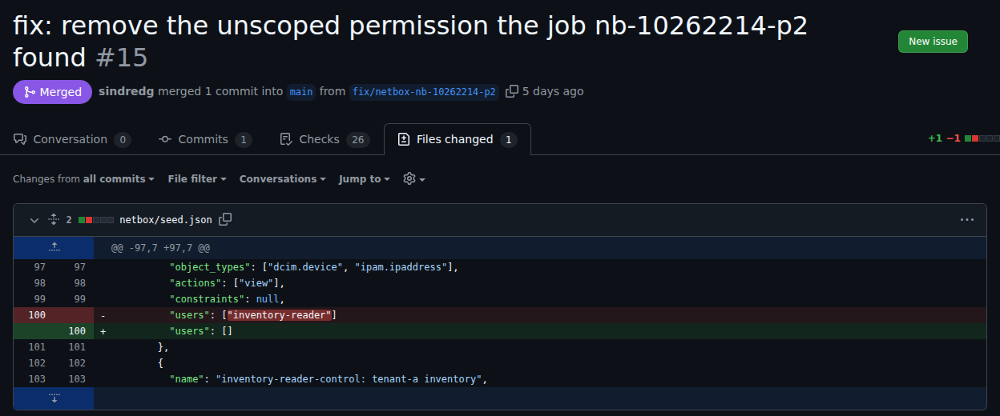

# AI Security Platform: investigating findings and testing proposed fixes

Can an AI agent investigate a security finding and propose a fix without getting permission to change the system itself? This Azure lab tested that question on NetBox, a service for recording network infrastructure, using synthetic accounts, inventory, and deliberately introduced weaknesses.

The model ran inside the platform on CPU. It could read evidence and propose a change; separate checks and a human approval controlled whether that change reached NetBox.

The infrastructure has been removed. These pages describe the system as it ran; project status is on the [roadmap](docs/roadmap.md#status).

## Results

**The tests did not demonstrate an investigative benefit from adding the model to the account-access exercise.** Conventional checks already held the facts needed to decide whether an account had too much or too little access. The model read the same evidence and sometimes misread it ([comparison and limits](docs/close.md#the-models-place)).

The tests also examined whether the platform could constrain an unreliable model. A wrong answer and a successfully blocked answer are different results, so the findings describe both.

| Question | Observation | Limit and evidence |
| --- | --- | --- |
| Could the worker cross its access boundaries? | None of 42 tested probes succeeded | Several paths remained unprobed; [containment findings](docs/close.md#containment) |
| Could evidence instruct the model? | It followed an injected instruction in 1 of 4 finished live jobs; the verification gate stopped that job | Small sample; [model reliability](docs/close.md#model-reliability) |
| Could a proposed fix reach the target safely? | One fix passed the checks, received signed approval, was delivered, and was rolled back | One demonstrated delivery; [fix delivery](docs/close.md#fix-delivery) |
| Were all three exercises completed? | Account access had a delivered fix; network access was detected; a vulnerable image was replaced | No network fix was proposed or delivered; [exercise results](docs/close.md#what-it-showed) |

The [findings and limitations](docs/close.md) explain what each observation supports. The [comparison tables](docs/close.md#comparisons) distinguish account verdicts, jobs, and test cases, and identify changes that prevent a direct comparison.

## Start here

| To understand | Read in this order |
| --- | --- |
| The project and its conclusions | This overview → [findings and limitations](docs/close.md) → [architecture](docs/architecture.md) |
| Whether the evidence supports a claim | [Comparisons](docs/close.md#comparisons) → [selected evidence](docs/close.md#read-the-evidence) → [check coverage](docs/validation/README.md#what-the-checks-do-not-cover) |
| How to rebuild or inspect it | [Runbooks](docs/runbooks/README.md) → [components](docs/components/README.md) → [repository layout](#repository-layout) |

## How a fix gets made

The model can recommend a change that removes legitimate access. Exercise 1 therefore checks its answer and its proposed fix separately before allowing delivery.

1. **Collect evidence and run conventional checks:** One deterministic check reads an account's configured permissions; another reads what that account can actually retrieve. Both compare access with the written access specification.
2. **Ask the agent to investigate:** The agent reads that job's evidence through a tool service. It returns a structured output: an answer in a required format, with a verdict per account and any proposed permission removal.
3. **Compare verdicts:** The verification gate requires both checks to agree and the model to give the same verdict. Disagreement, missing information, or an unreadable verdict stops the workflow.
4. **Test the proposed change:** A policy check restricts what the fix may change; a staging test applies it to a separate copy of NetBox and checks access again. The operator publishes a pull request from checked fields ([the agent's job](docs/components/agent-job.md#after-the-output)).
5. **Approve and deliver the exact change:** The operator signs a tag approving one commit. Delivery applies it and checks the target again before the merge ([delivery runbook](docs/runbooks/proposals-and-delivery.md)).

This chain was demonstrated for account access. The planned network fix would skip the staging test, and no network fix was proposed ([exercise 2](docs/close.md#what-it-showed)).

See the delivered fix and its pull request

The fix for exercise 1's seeded weakness, proposed by the model, delivered to NetBox, and rolled back, as its pull request ([targets #15](https://github.com/sindredg/ai-security-platform-test/pull/15)):

The exact change it made, one line of the seed:

## What can go wrong

The model can misread evidence or follow instructions planted in it. A compromised target can also supply false evidence, so agreement between the model and the checks does not establish that the evidence is true ([threats and limits](docs/security/ai-threats.md)).

A job can stop halfway through a change. The [operational findings](docs/close.md#operations) and [standing weak points](docs/security/README.md#standing-weak-points) distinguish the recovery paths that were exercised from those that remain untested.

## Architecture

The trusted orchestrator runs the checks and holds the credentials. The AI worker runs the agent and model on a separate virtual machine (VM), with access limited on the assumption that it could be compromised.

Detailed breakdown in [Architecture](docs/architecture.md).

<strong>The names in the diagram</strong>

| Term | What it is |
| --- | --- |
| Orchestrator | The trusted VM. It runs the workflow and holds the secrets |
| AI worker | The VM that runs the model and the agent. The design assumes it can be compromised |
| Edge VM | The Squid forward proxy, with an Azure NAT gateway for outbound internet access |
| Router | The mesh VPN's subnet router, and its only node in Azure. It carries operator access to the other VMs |
| Just-in-time (JIT) egress window | A time-limited allowlist: an operator command on the edge VM that opens code and package hosts for at most 60 minutes |

## Why it looks like this

| Concern | Design answer | Decided in |
| --- | --- | --- |
| Evidence reaching a model vendor | Open-weight model on CPU, inside the platform. No external model API | [Architecture](docs/architecture.md#why-the-model-runs-inside-the-platform) |
| The agent compromised by what it reads | Own VM, no cluster credentials. Reaches only the tool service, using Model Context Protocol (MCP), and two package hosts | [0005](docs/decisions/0005-ai-workers-on-a-separate-vm.md), [0011](docs/decisions/0011-package-proxy-for-the-worker.md) |
| A compromised orchestrator | No direct internet. Outbound access goes through the edge VM's proxy | [0020](docs/decisions/0020-an-edge-vm-for-the-way-out-and-the-mesh.md) |
| The mesh VPN vendor | Its only node is a separate router VM. SSH certificates expire within 12 hours | [0025](docs/decisions/0025-the-mesh-node-on-its-own-vm.md), [0022](docs/decisions/0022-short-lived-ssh-certificates-for-the-operator.md) |
| A compromised target | Reaches nothing outside its own network. Own repository, state, and identity | [0002](docs/decisions/0002-separate-platform-and-target-infrastructure.md), [0024](docs/decisions/0024-the-targets-in-their-own-repository-and-signed-commits.md) |
| Exposure to the internet | No VM has a public address. An Azure policy refuses one | [0009](docs/decisions/0009-one-egress-point-on-the-orchestrator-subnet.md) |

Three regions, because the lab had a quota of 4 virtual CPUs per region ([0003](docs/decisions/0003-region-pair.md), [0020](docs/decisions/0020-an-edge-vm-for-the-way-out-and-the-mesh.md)).

## Find your way around

| Question | Page |
| --- | --- |
| What was learned, and what remains unproved? | [Findings and limitations](docs/close.md) |
| What was implemented? | [Roadmap](docs/roadmap.md#status), [architecture](docs/architecture.md), [components](docs/components/README.md) |
| Why these design choices? | [Decision records](docs/decisions/README.md) |
| What does a term mean? | [Glossary](docs/glossary.md) |
| What supports a result? | [Selected evidence](docs/close.md#read-the-evidence), [all test runs](docs/evidence/README.md), [lessons](docs/evidence/lessons.md) |
| What do the automated checks cover? | [Validation](docs/validation/README.md) |
| What commands produced the results? | [Worklogs](docs/worklogs/README.md) |
| Which threats and limitations remain? | [Security](docs/security/README.md), [lab against production](docs/security/lab-vs-production.md) |
| How can it be rebuilt? | [Runbooks](docs/runbooks/README.md) |
| What failed during development, and why? | [Troubleshooting](docs/troubleshooting/README.md) |

## Repository layout

Show the directories

| Path | What it holds | Described in |
| --- | --- | --- |
| [`infra/bootstrap/`](infra/bootstrap/) | Terraform the operator applies first: resource groups, state storage, both deployment identities, the public address policy, and the flow logs and Activity Log alerts neither identity can reach | [Identities and state](docs/components/identities-and-state.md) |
| [`infra/platform/`](infra/platform/) | Platform Terraform: networks, security group rules, the NAT gateway, all four VMs, their first-boot templates, and the Log Analytics workspace with its private endpoint and alert rules | [Egress and policy](docs/components/egress-and-policy.md), [orchestrator](docs/components/orchestrator.md), [AI worker](docs/components/ai-worker.md) |
| [`ai-security-platform-test`](https://github.com/sindredg/ai-security-platform-test) | A separate repository. Terraform for the target network, and NetBox and its consumer | [ADR 0002](docs/decisions/0002-separate-platform-and-target-infrastructure.md), [ADR 0024](docs/decisions/0024-the-targets-in-their-own-repository-and-signed-commits.md) |
| [`infra/modules/network/`](infra/modules/network/) | The network module both sides use | [Architecture](docs/architecture.md) |
| [`platform/argo/`](platform/argo/) | Argo Workflows: its pins, controller, accounts, network policies, and the workflow template, and the scripts that fetch and install them and make the dispatch key | [Workflows runbook](docs/runbooks/workflows.md) |
| [`platform/dispatch/`](platform/dispatch/) | The image of the workflow's dispatch and comparison steps: their code, tests, and Dockerfile | [ADR 0030](docs/decisions/0030-how-a-job-reaches-the-worker.md), [ADR 0041](docs/decisions/0041-the-workflow-compares-the-models-verdict-with-the-checks.md) |
| [`platform/logs/`](platform/logs/) | Host units and scripts on the orchestrator that copy the tool service's audit lines and pull the AI worker's journal into append-only files, and their tests | [Audit log](docs/security/audit-log.md) |
| [`platform/monitoring/`](platform/monitoring/) | The script that writes the monitoring private endpoint's addresses into the hosts file of each VM with a log agent | [Monitoring](docs/components/monitoring.md) |
| [`platform/target-images/`](platform/target-images/) | The script that fetches NetBox's image by digest during a JIT egress window, and checks it before it goes to the NetBox VM | [NetBox runbook](docs/runbooks/netbox.md) |
| [`platform/target-update/`](platform/target-update/) | The update run, which brings the targets' packages through a port the orchestrator forwards, and its install script | [Targets runbook](docs/runbooks/targets.md) |
| [`platform/tool-service/`](platform/tool-service/) | Kubernetes manifests and scripts that deploy the tool service to K3s: namespaces, network policies, the pod, the certificate, job registration, and the synthetic evidence | [Tool service](docs/security/tool-service.md#deployment-controls), [checks](docs/validation/tool-service.md) |
| [`edge/`](edge/) | The JIT egress window command and the list of hosts Squid opens during a window, both installed on the edge VM | [Package proxy](docs/components/package-proxy.md#the-jit-egress-window) |
| [`worker/model-server/`](worker/model-server/) | Pins, download, build, and install scripts for the model server on the AI worker | [Runbook](docs/runbooks/model-server.md) |
| [`worker/log-export/`](worker/log-export/) | The forced command on the AI worker that hands its journal to the orchestrator's pull, and its install script | [Audit log](docs/security/audit-log.md#the-workers-journal) |
| [`worker/feed/`](worker/feed/) | The forced command of the feed account on the AI worker, which only unpacks staged files, and its install script | [ADR 0026](docs/decisions/0026-the-feed-key-gets-its-own-account-on-the-worker.md) |
| [`worker/agent-runtime/`](worker/agent-runtime/) | Pins, install, and run scripts for the agent runtime, the job runner and its socket unit, and the fixture tool | [Runbook](docs/runbooks/agent-runtime.md) |
| [`tool-service/`](tool-service/) | The tool service: its code, tests, and Dockerfile | [Tool service](docs/security/tool-service.md) |
| [`collectors/netbox/`](collectors/netbox/) | NetBox's collector: each account's access by its permissions and by what its token returns, a job's evidence, the task, and the held-out cases | [Evidence collection](docs/runbooks/evidence-collection.md), [investigation](docs/validation/investigation.md) |
| [`policies/`](policies/) | The tool service policy: the tools and arguments each job may use | [Tool service](docs/security/tool-service.md) |
| [`validation/`](validation/) | The script that runs every check against the live system, and the test evidence's record builder and page generator | [Validation](docs/validation/README.md), [test evidence](docs/runbooks/test-evidence.md) |
| [`.github/`](.github/) | The checks on every pull request, the image build, and the signature check with its allowed signers | [Pipeline](docs/components/pipeline.md) |
| [`docs/`](docs/) | Everything in [Find your way around](#find-your-way-around) | |

## What this is not

- **Not production:** one node, one operator, no high availability.
- **Not real target inventory:** the devices and accounts in NetBox are synthetic.
- **Not protection from Azure:** the provider and the platform administrator are trusted ([trust boundaries](docs/architecture.md#trust-boundaries)).

## License

[MIT](LICENSE).
