# Architecture

How the system is built now. Status per milestone is in the [roadmap](roadmap.md#status), the reasons in the [decision records](decisions/README.md), and what each test run showed in the [evidence](evidence/README.md).

A workflow on the orchestrator hands each investigation to the AI worker over SSH. The agent reads evidence only through the tool service on the orchestrator, with a token for that one job. Its answer comes back to the workflow, which stops unless the model's verdicts match the deterministic checks.

## Purpose

Finding a misconfiguration is only the start. The real work is a fix that removes the problem without breaking the service's consumers, proven before anyone approves it. The [workflow](#workflow) goes from evidence to an approved, verified change.

This is an infrastructure project. Existing software supplies the workflow engine, the agent runtime, and the interfaces, and custom code stays small: collectors, adapters, and enforcement checks.

### Why the model runs inside the platform

The model is open-weight and runs on CPU on the AI worker, with no external model API.

| Reason | What it gives |
| --- | --- |
| The evidence stays inside | Findings, target configuration, and tool output never reach a model vendor. With no internet path, the model has nowhere to send them |
| Every layer is the project's | The operating system, network rules, model server, and model are configured and checked here |
| The model can change | Swapping or tuning it needs no vendor's terms or quota |

The cost is quality and speed. A small model on 2 vCPUs proves the integration, and says little about how good or fast an investigation can be.

## System overview

The worker cannot reach the target region. Everything it knows about the target, a tool service on the orchestrator handed it. The diagram draws the design, delivery and the rehearsal copy included since milestone 5.

## Platform and target separation

The platform holds the credentials and rules that decide what may change. The target is deliberately weak and rebuilt often. Sharing a Terraform configuration, network, or permission scope would let a mistake in one reach the other ([ADR 0002](decisions/0002-separate-platform-and-target-infrastructure.md)).

| Aspect | Platform | Targets |
| --- | --- | --- |
| Region | Sweden Central | Poland Central. Resource groups and state in Denmark East ([ADR 0020](decisions/0020-an-edge-vm-for-the-way-out-and-the-mesh.md)) |
| Terraform root, each with its own state account | `infra/platform/` | `infra/targets/` in the [targets repository](https://github.com/sindredg/ai-security-platform-test) ([ADR 0024](decisions/0024-the-targets-in-their-own-repository-and-signed-commits.md)) |
| Resource groups | `rg-aisec-platform`, `rg-aisec-platform-state` | `rg-aisec-targets`, `rg-aisec-targets-state` |
| Virtual network | `10.40.0.0/20` | `10.50.0.0/20` |
| Deployment identity | `aisec-platform-deploy`, platform scope only | `aisec-targets-deploy`, target scope only |
| Lifecycle | Long-lived | Rebuilt and reseeded per exercise, with seeded weaknesses inside outer containment |

Separate folders prove nothing. The boundary is state permissions, role assignments, network rules, and credentials, and each identity was denied every read and write it tried on the other side ([worklog](worklogs/0001-network-foundation.md#identity-separation)).

A third root, `infra/bootstrap`, run by the operator, creates what a scoped identity cannot: resource groups, state accounts, identities, and role assignments ([ADR 0008](decisions/0008-deployment-identities-and-bootstrap-scope.md)). Its one deliberate hole lets each identity name the other side's network as a peering partner, and nothing more.

- **A target change never touches the platform.** A remediation can modify allowlisted target fields, and nothing of the platform's Terraform, policies, workflows, or CI.
- **Containment is not a target setting.** The rules that keep the lab private belong to the platform side, and no target change can remove them.

## Network

### Address plan

Every subnet has its own network security group and no default outbound access.

| Range | Region | Use |
| --- | --- | --- |
| `10.40.0.0/20` | Sweden Central | Platform virtual network |
| `10.40.0.0/27` | Sweden Central | Orchestrator subnet |
| `10.40.0.32/27` | Sweden Central | AI worker subnet |
| `10.40.0.64/27` | Sweden Central | Private endpoint for Azure Monitor ([ADR 0021](decisions/0021-monitoring-in-azure-monitor-over-private-link.md)) |
| `10.45.0.0/24` | Denmark East | Edge virtual network |
| `10.45.0.0/27` | Denmark East | Edge subnet, with the edge VM at `10.45.0.4` |
| `10.45.0.32/27` | Denmark East | Router subnet, with the router at `10.45.0.36` |
| `10.50.0.0/20` | Poland Central | Target virtual network |
| `10.50.0.0/27` | Poland Central | NetBox subnet |
| `10.50.0.32/27` | Poland Central | Authorized consumer viewpoint |
| `10.50.0.64/27` | Poland Central | Unintended viewpoint (exercise 2) |
| `10.50.1.0/27` | Poland Central | Rehearsal copy |
| `10.42.0.0/16`, `10.43.0.0/16` | In cluster | K3s pod and service ranges, never routed between networks |

### Connectivity

Global peering joins platform to targets, platform to edge, and edge to targets (`Z.15`, `Z.18`, `Z.24`). Peering puts the other network inside Azure's `VirtualNetwork` tag, which the built-in rules allow. So each security group ends in a deny-all rule in both directions at priority 4096, and allows only the drawn flows.

The rule behind each path is in [egress and policy](components/egress-and-policy.md). An allowed route is not authorization: every allowed flow still needs application authentication and TLS.

### Administrative access

No VM has a public address. The operator reaches the VMs over a mesh VPN whose only node is a router VM ([ADR 0025](decisions/0025-the-mesh-node-on-its-own-vm.md), [mesh VPN](components/mesh-vpn.md)). No firewall rule names an operator address.

The administrator account on every VM takes only an SSH certificate that expires after 12 hours ([ADR 0022](decisions/0022-short-lived-ssh-certificates-for-the-operator.md)). The orchestrator's feed key logs in to its own account on the worker, which can only unpack staged files ([ADR 0026](decisions/0026-the-feed-key-gets-its-own-account-on-the-worker.md)).

### Egress

The one way out is a NAT gateway in the edge network, used by the router and the edge VM. The orchestrator, the worker, and the targets each have three outbound controls, because any one alone leaves a path open: no outbound method, explicit deny rules, and Azure Policy assigned outside both roots.

The worker gets two Ubuntu package hosts through Squid on the edge VM ([ADR 0020](decisions/0020-an-edge-vm-for-the-way-out-and-the-mesh.md)). The orchestrator gets its package mirror, and the build and deploy hosts only during an operator's fetch window. The targets get no path: the orchestrator brings what they need ([egress and policy](components/egress-and-policy.md), [package proxy](components/package-proxy.md)).

## Platform

### Orchestrator

One K3s server on one VM runs everything that is trusted. It has no way out of its own and fetches through Squid on the edge VM. Detail: [orchestrator](components/orchestrator.md), [K3s](components/k3s.md).

### AI worker

The model server and the agent runtime run on a second VM outside the cluster. The worker reads advisories, target evidence, and tool output, and any of those can carry malicious instructions. So the design assumes it can be compromised:

- No delivery credentials, no repository credentials, no privileged cloud identity.
- One scoped session per job: one target, one evidence set, bounded time and output.
- One network destination for work: the tool services on the orchestrator.

The cost is dispatch: a workflow step opens SSH to the worker with a key that can only start the job's sandboxed unit ([ADR 0012](decisions/0012-dispatch-over-ssh-with-a-forced-command.md), [ADR 0030](decisions/0030-how-a-job-reaches-the-worker.md), [AI worker](components/ai-worker.md)).

### What a job does today

A job reads evidence through one tool, `get_evidence`, on `synthetic`, a fixed file, or `netbox`, whose evidence is collected for that job alone ([ADR 0040](decisions/0040-a-jobs-evidence-is-collected-on-the-hosts-and-stored-per-job.md)). What each job answered is in the [evidence](evidence/README.md), and every part and pin in [components](components/README.md).

## Targets

The first target is NetBox with synthetic inventory ([ADR 0004](decisions/0004-netbox-as-first-target.md)). NetBox is the thing being investigated, never a source of truth: the platform's target registry, permissions, and approval policy come from nothing it returns.

| Fixture | Role |
| --- | --- |
| NetBox VM | NetBox from one image pinned by digest, under Podman, with PostgreSQL and Valkey from Ubuntu ([ADR 0035](decisions/0035-netbox-from-its-image-with-the-database-from-ubuntu.md), [ADR 0039](decisions/0039-netbox-takes-a-clients-address-from-the-connection.md)) |
| Authorized consumer | Reads one tenant's devices and addresses with a read-only token limited to its address. Two accounts on the lab VM: the consumer and a control ([ADR 0037](decisions/0037-an-unscoped-copy-of-the-consumers-permission.md)) |
| Unintended viewpoint | A source that policy says must not reach NetBox. Comes with exercise 2 |
| Rehearsal copy | A second NetBox on the lab VM, with its own interface and credentials, reset from a dump. Only the orchestrator reaches it over the network ([ADR 0044](decisions/0044-the-rehearsal-copy-is-a-second-netbox-on-the-lab-vm.md)) |

The viewpoints and the rehearsal copy share one lab VM, one network interface per viewpoint subnet, because of [capacity](#capacity). Neither target VM reaches anything, and packages arrive only during an update run from the orchestrator ([ADR 0036](decisions/0036-target-packages-through-a-port-the-orchestrator-forwards.md)).

### Exercises

Three exercises, in order, on the same service and consumer contract.

| Order | Finding | Correct outcome | Change surface |
| --- | --- | --- | --- |
| 1 | The consumer can read inventory outside its approved scope | Required reads still work, other records are gone | NetBox permission configuration |
| 2 | NetBox is reachable from the unintended viewpoint | The consumer keeps access, the unintended source is blocked | Target network rules |
| 3 | A pinned image or dependency is affected by a real public advisory | A vetted update removes the condition and keeps data and the consumer contract intact | Pinned image definition and update procedure |

The easy way to pass a security check is to break the service. So a fix that locks out the legitimate consumer fails, and validation checks the inventory the consumer gets back, not a health endpoint.

## Workflow

1. Collection runs on a schedule or on request and produces validated evidence snapshots.
2. Deterministic checks establish configured access, observed reachability, and candidate findings.
3. A workflow fixes the job scope: target, evidence, tools, time and output limits.
4. An AI worker investigates and asks for more evidence through tool services.
5. The model answers through a final output checked against a schema, and the worker writes from it the lines the comparison reads. A proposed fix removes one permission from one account ([ADR 0043](decisions/0043-proposals-are-remove-only-and-a-policy-check-decides.md), [ADR 0049](decisions/0049-a-netbox-jobs-answer-is-a-final-output-checked-against-a-schema.md)).
6. On the orchestrator host, a policy check decides whether the fix is allowed, and a rehearsal applies it to the rehearsal copy and runs both checks there ([ADR 0044](decisions/0044-the-rehearsal-copy-is-a-second-netbox-on-the-lab-vm.md)).
7. The operator's machine opens a pull request in the targets repository from the checked fields, never the answer's text. The platform holds no repository credential ([ADR 0045](decisions/0045-the-operator-publishes-a-checked-proposal.md)).
8. The operator approves the pull request's head with a tag signed by a separate approval key, for one delivery within a day ([ADR 0046](decisions/0046-a-signed-tag-approves-and-delivery-checks-before-the-merge.md)).
9. Delivery, a root command on the orchestrator, verifies the tag, applies the change with a token made for that delivery, and runs both checks after it ([ADR 0047](decisions/0047-a-delivery-token-for-each-delivery.md)).
10. The pull request merges only after those checks pass, and a required check refuses it unless its head carries an approval ([ADR 0050](decisions/0050-a-guarded-change-merges-only-with-an-approval-on-its-head.md)). A rollback delivers `main`'s head again, with its own approval.

Models explain and propose. Tools establish facts. A confident model does not authorize a change, and neither does a green test.

A proposal goes ahead only when the model's verdict agrees with the deterministic checks ([ADR 0041](decisions/0041-the-workflow-compares-the-models-verdict-with-the-checks.md)). Anything else stops the workflow, so a wrong verdict costs the operator a look instead of a wrong pull request. All ten steps are built, with collection, the proposal, publishing, approval, and delivery each on the operator's request.

## Trust boundaries

| Component | Trust | Reason |
| --- | --- | --- |
| Cloud provider, platform administrator | Trusted | Accepted baseline. A privileged provider compromise is documented, not mitigated |
| Orchestrator and its workflow templates | Trusted | Fixed, and not writable by workers |
| AI worker, model output | Untrusted | Assumed compromisable. Limited by network, credentials, and tool-side checks |
| Target, guest reports, API responses | Untrusted | A compromised target can forge its own evidence |
| Advisories, tool results, proposed patches | Untrusted input | Can carry instructions or unsafe changes |

What follows from that:

- Every tool call is authorized on the server: caller, job scope, target, operation, arguments. Hiding a tool from the model is not access control.
- Target evidence is compared with what the repository, the cloud API, and the network say. A disagreement is recorded, and the model does not pick a winner.
- Approval binds to a commit and a target. Change the proposal and the approval is void.
- Workflow parameters and logs carry references, except a job's answer and transcript, kept in the workflow for 24 hours ([accepted risks](security/accepted-risks.md)).
- The repository is public. Pull requests carry synthetic data and sanitized summaries, never state, raw plans, or secrets.

## Security practices

Each practice lands with the milestone that builds what it checks ([ADR 0010](decisions/0010-threat-model-and-security-checks-per-milestone.md)). A practice without a gate has no check that it was done.

| Practice | State |
| --- | --- |
| Threat model | Written, and revised with each milestone ([threat model](security/threat-model.md)) |
| Repository protection | Verified: required checks refuse commits the operator's key did not sign, in both repositories, and unapproved seed changes in the targets one ([pipeline](components/pipeline.md#repository-settings)). Push protection: configured, not tested |
| Static checks on pull requests | Built, with no cloud credentials ([pipeline](components/pipeline.md#checks-on-every-pull-request)). Trivy fails SSH from any source, and the network module refuses it at plan |
| Dependency updates | Verified for the tool service's packages: Dependabot's [#190](https://github.com/sindredg/ai-security-platform/pull/190) failed the [signature check](components/pipeline.md#the-signature-check) as designed, and was redone signed in [#193](https://github.com/sindredg/ai-security-platform/pull/193). None yet for an action or a provider |
| Hardening baselines | kube-bench and Lynis on the platform VMs, findings triaged ([hardening](security/hardening.md#benchmarks)), one unexplained ([#127](https://github.com/sindredg/ai-security-platform/issues/127)). Lynis not run on the targets. No CIS profile for Ubuntu 26.04: accepted |
| Credential inventory | Every credential through milestone 5. The GitHub App key was never made. Most rotation procedures have not been run ([inventory](security/credentials.md)) |
| Audit log of tool calls | Verified: an append-only copy on the orchestrator and in Azure Monitor (`L.1` to `L.7`, `O.1`). Root can edit it first ([audit log](security/audit-log.md)) |
| Supply chain | Verified per artifact (`T.2`, `W.2`, `W.9`, `G.1`, `K.11`, `N.5`). No SBOM ([supply chain](security/supply-chain.md)) |
| Monitoring | Verified: three agents over Private Link, each alert fired once on purpose (`O.1` to `O.17`). The targets have no agent ([monitoring](components/monitoring.md)) |
| Incident response runbook | Planned |

There is no compliance framework. ISO 27001 and SOC 2 describe an organisation, and this one has a single operator.

## Identity

| Who | How | Limit |
| --- | --- | --- |
| Operator | Microsoft Entra ID sign-in, with no premium identity features | One person investigates and approves: no separation of duties |
| Workloads | Collector, tool service, dispatch step, and worker each have their own credentials. Proposal and delivery are root commands on the orchestrator host, with a token made for each delivery | No repository credential anywhere on the platform ([ADR 0045](decisions/0045-the-operator-publishes-a-checked-proposal.md)) |
| Jobs | A random token per job, scoped to one target and a list of tools, revoked when the job ends ([ADR 0013](decisions/0013-a-token-per-job-and-no-cloud-identity-yet.md)) | The tool service checks it on every call ([tool service](security/tool-service.md)) |
| Cloud access from K3s | None yet ([ADR 0013](decisions/0013-a-token-per-job-and-no-cloud-identity-yet.md)) | Chosen when the first workload needs it |

## Capacity

The subscription allows 4 vCPUs per region and no GPU, and the limit cannot be raised. Quota counts VMs that exist, not VMs that run, so two VMs fill a region ([preflight](worklogs/0000-azure-preflight.md)).

| Region | VM, 2 vCPUs each | Size |
| --- | --- | --- |
| Sweden Central | Orchestrator | `Standard_B2as_v2`, 8 GB |
| Sweden Central | AI worker | `Standard_D2ps_v6`, Arm, 8 GB |
| Denmark East | Router | `Standard_B2ats_v2`, 1 GB |
| Denmark East | Edge | `Standard_B2als_v2`, 4 GB |
| Poland Central | NetBox | `Standard_B2as_v2`, 8 GB, zone 3 |
| Poland Central | Lab | `Standard_B2as_v2`, 8 GB, zone 3 |

- **Inference.** Two x64 vCPUs are one physical core, so the worker is Arm: two real cores, at the price of arm64 builds.
- **The orchestrator.** Over 15.3 hours its CPU averaged 3.3 %, and available memory never fell below 5,389 of 7,881 MB ([worklog](worklogs/0003-toolchain-integration.md#orchestrator-footprint)).
- **Concurrency.** One investigation at a time and one loaded model, so no model gateway ([ADR 0034](decisions/0034-no-model-gateway-while-there-is-one-backend.md)).

The code's layout is in the [README](../README.md#repository-layout).

## Open decisions

Each gets a decision record before the milestone that depends on it.

| Decision | Needed before |
| --- | --- |
| Cloud identity for K3s workloads | A collector that reads from Azure |
| Worker isolation beyond VM separation | Connecting real target evidence |
| Acceptance thresholds for quality, recovery, and cost | Operational drills |

## Limitations

- One K3s node and single VMs. A VM failure stops that part of the system.
- Investigations are slow: a completed scored job took 4.8 to 13.6 minutes in the workflow ([evidence](evidence/2026-10-25-2308-scored-cases.md)).
- One operator. Automated checks are the only second reader of a change.
- A separate VM limits what a compromised worker can reach, and does nothing against a compromised host or provider.
- Both roots use the same network module, so a change to it reaches both sides.
- The platform identity can create a public IP resource in its own group, which the NAT gateway needs, and cannot attach it to a machine ([worklog](worklogs/0002-platform-compute.md#public-address-policy)).
- The orchestrator's way out is filtered by hostname, not by content, and TLS is not inspected (T40).
- With the edge VM or the router down, the way in is Azure run command, which needs the Owner account (T03).
- The [threat model](security/threat-model.md) is the designer's, with no outside review. Controls for milestone 6 and later are planned or open.
