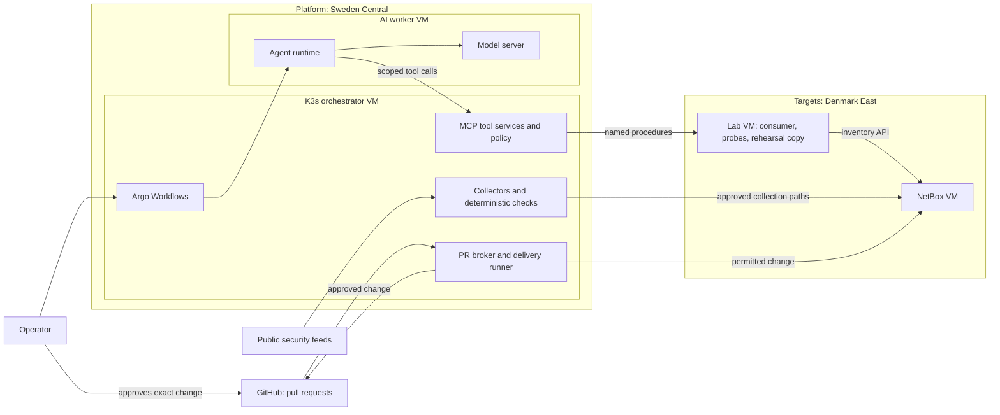

# Architecture

This is the planned system. None of it is deployed. Each section says what is decided, what is only proposed, and what is still open.

The reasoning behind each choice is in the [decision records](decisions/README.md). The order of work is in the [roadmap](roadmap.md).

## Purpose

Finding a misconfiguration is the easy part. The hard part is proposing a fix that removes the problem without breaking the people who depend on the service, and proving that before anyone approves it.

That is what this platform does, for a service it does not host:

- Tools collect evidence and establish facts: configured access, observed reachability, deployed versions.
- AI workers read the evidence, ask for more through narrow tools, and propose a bounded change.
- A trusted runner rehearses the change on a disposable copy of the target.
- A pull request carries the change and its evidence to the operator.
- After approval, a trusted delivery step applies it, and fresh collection checks the result.

This is an infrastructure project. The work is Terraform, Kubernetes operations, model hosting, identity, networking, isolation, and drills. Existing software supplies the workflow engine, the agent runtime, and the user interfaces. Custom code stays small: collectors, adapters, and enforcement checks.

## System overview



Note what is missing from the diagram: any line from the AI worker to the targets. The worker cannot reach the target region at all. Everything it knows about the target, it was handed by a tool service on the orchestrator.

## Platform and target separation

The platform holds the credentials and rules that decide what may change. The target is deliberately weak and gets rebuilt often. Putting them in the same Terraform configuration, network, or permission scope would let a mistake in one reach the other.

So they share one Azure subscription and nothing else. See [ADR 0002](decisions/0002-separate-platform-and-target-infrastructure.md).

| Aspect | Platform | Targets |
| --- | --- | --- |
| Purpose | Orchestration, tools, AI workers, inference | The service under investigation and its lab fixtures |
| Region | Sweden Central | Denmark East |
| Terraform root | `infra/platform/` | `infra/targets/` |
| Terraform state | Own storage account, own access scope | Own storage account, own access scope |
| Resource groups | Platform only | Targets only |
| Virtual network | `10.40.0.0/20` | `10.50.0.0/20` |
| Deployment identity | Platform scope only | Target scope only |
| Lifecycle | Long-lived | Rebuilt and reseeded per exercise |
| Intentional weaknesses | None | Seeded per exercise, inside outer containment |

Separate folders prove nothing. The boundary is real only where state permissions, role assignments, network rules, and separate credentials enforce it.

Two rules follow:

- **A target change never touches the platform.** A remediation can modify allowlisted target fields. Platform Terraform, policies, workflows, and CI are out of its reach.
- **Containment is not a target setting.** The rules that keep the lab private belong to the platform side. No target change can remove them, approved or not.

## Network

### Address plan

Proposed. Nothing exists yet that could conflict with it.

| Range | Region | Use |
| --- | --- | --- |
| `10.40.0.0/20` | Sweden Central | Platform virtual network |
| `10.40.0.0/27` | Sweden Central | Orchestrator subnet |
| `10.40.0.32/27` | Sweden Central | AI worker subnet |
| `10.50.0.0/20` | Denmark East | Target virtual network |
| `10.50.0.0/27` | Denmark East | NetBox subnet |
| `10.50.0.32/27` | Denmark East | Authorized consumer viewpoint |
| `10.50.0.64/27` | Denmark East | Unintended viewpoint (exercise 2) |
| `10.50.1.0/27` | Denmark East | Rehearsal copy |
| `10.42.0.0/16`, `10.43.0.0/16` | In cluster | K3s default pod and service ranges, never routed between networks |

### Connectivity

Global virtual network peering joins the two networks. Peering is plumbing, not a filter: once it exists, everything can route to everything. Network security groups on both sides deny by default and allow only what is listed here.

| Source | Destination | Purpose | State |
| --- | --- | --- | --- |
| Orchestrator subnet | NetBox subnet | Evidence collection, approved delivery | Allowed, fixed ports |
| Orchestrator subnet | Viewpoint and rehearsal subnets | Start named probes and rehearsals | Allowed, fixed ports |
| Orchestrator subnet | AI worker subnet | Dispatch jobs | Allowed |
| AI worker subnet | Orchestrator subnet | Tool services only | Allowed, fixed ports |
| AI worker subnet | Target network | None | Denied |
| AI worker subnet | Internet | None once models and images are in place | Denied |
| Target network | Platform network | None | Denied for new connections |
| Operator device | Orchestrator, then other VMs | Administration over the mesh VPN | Allowed for signed-in operator devices |
| Internet | Any | None | Denied inbound |

An allowed route is not authorization. Every allowed flow still needs application authentication and TLS.

### Administrative access

No VM has a public address. The operator gets in over a mesh VPN: the orchestrator runs the agent and routes to both networks. No firewall rule names an operator address, because none is needed. See [ADR 0007](decisions/0007-mesh-vpn-for-administrative-access.md).

Still open: how images and packages get downloaded, and private DNS. See [Open decisions](#open-decisions).

## Platform

### Orchestrator

One K3s server on one VM runs everything that is trusted. See [ADR 0001](decisions/0001-k3s-for-initial-orchestration.md).

| Namespace | Workloads | Responsibility |
| --- | --- | --- |
| `orchestration` | Argo Workflows controller and server, fixed workflow templates | Scheduling, retries, concurrency limits, operator UI |
| `collection` | Collectors and deterministic checks | Read approved sources, correlate advisories locally |
| `tool-services` | Narrow MCP servers and the policy check | Check caller, job, target, operation, and arguments on every call |
| `change` | PR broker and delivery runner | Publish permitted patches, apply approved changes |
| `observability` | Metrics and logs, sized after measurement | Operational and audit visibility without private payloads |

Namespaces keep things tidy. They are not a wall against malicious code, and nothing here relies on them as one.

### AI worker

The agent runtime and the model server run on a second VM that is not part of the cluster. See [ADR 0005](decisions/0005-ai-workers-on-a-separate-vm.md).

The worker reads advisories, target evidence, and tool output. Any of those can carry instructions. So the design assumes the worker can be turned, and gives it nothing worth stealing:

- No delivery credentials, no repository credentials, no privileged cloud identity.
- One scoped session per job: one target, one evidence set, bounded time and output.
- One network destination: the tool services on the orchestrator.

The cost is dispatch. Argo runs pods, not processes on another machine. How a workflow hands a job to the worker is the first real integration risk, and still open.

### Candidate components

Candidates, not selections. Each has something to prove first.

| Role | Candidate | Has to prove |
| --- | --- | --- |
| Workflow engine and UI | Argo Workflows | Dispatch to the worker VM, restart recovery, footprint |
| Agent runtime | Goose | Headless runs, a restricted tool set, a private model endpoint |
| Model server | llama.cpp | Tool-call format, memory, throughput on the chosen VM size |
| Starting model | Qwen3-4B-Instruct-2507, quantized | Structured output and tool calling on held-out fixtures |
| Model gateway | LiteLLM | That it earns its footprint while there is only one model backend |
| Deterministic checks | Trivy, Checkov, Nmap, OPA | Coverage for the selected exercises |
| Metrics and dashboards | Prometheus, Grafana | That they fit on the orchestrator |

## Targets

The first target is NetBox with synthetic inventory. See [ADR 0004](decisions/0004-netbox-as-first-target.md).

| Fixture | Role |
| --- | --- |
| NetBox VM | The protected service: NetBox with its database, cache, and worker, from pinned container images |
| Authorized consumer | Reads a defined inventory subset through the REST API with a read-only token |
| Unintended viewpoint | A controlled source that policy says must not reach NetBox |
| Rehearsal copy | A disposable NetBox with its own synthetic data and credentials |

The consumer, both viewpoints, and the rehearsal copy share one lab VM, with one network interface per viewpoint subnet. That is a capacity compromise, explained under [Capacity](#capacity).

NetBox is the thing being investigated. It is never a source of truth for the platform. The platform's target registry, permissions, and approval policy do not come from anything NetBox returns.

### Exercises

Three exercises, in this order, on the same service and the same consumer contract.

| Order | Finding | Correct outcome | Change surface |
| --- | --- | --- | --- |
| 1 | The consumer can read inventory outside its approved scope | Required reads still work, other records are gone | NetBox permission configuration |
| 2 | NetBox is reachable from the unintended viewpoint | The consumer keeps access, the unintended source is blocked | Target network rules |
| 3 | A pinned image or dependency is affected by a real public advisory | A vetted update removes the condition and keeps data and the consumer contract intact | Pinned image definition and update procedure |

The easy way to pass a security check is to break the service. So a fix that locks out the legitimate consumer fails, and validation checks the inventory the consumer actually gets back, not a health endpoint.

## Workflow

1. Collection runs on a schedule or on request and produces validated evidence snapshots.
2. Deterministic checks establish configured access, observed reachability, and candidate findings.
3. A workflow fixes the job scope: target, evidence, tools, time and output limits.
4. An AI worker investigates and asks for more evidence through tool services.
5. The worker proposes a change, limited to allowlisted fields or a vetted procedure.
6. A trusted runner rehearses the change on the rehearsal copy and runs fixed tests.
7. The broker opens a pull request with the change, the evidence, and what remains uncertain.
8. The operator approves the exact commit and target.
9. The delivery runner re-checks policy and applies the change.
10. Fresh collection verifies the outcome. Cleanup retires the session and temporary resources.

Models explain and propose. Tools establish facts. A confident model does not authorize a change, and neither does a green test.

## Trust boundaries

| Component | Trust | Reason |
| --- | --- | --- |
| Cloud provider, platform administrator | Trusted | Accepted baseline. A privileged provider compromise is a risk this design documents and does not mitigate |
| Orchestrator and its workflow templates | Trusted | Fixed, and not writable by workers |
| AI worker, model output | Untrusted | Assumed compromisable. Limited by network, credentials, and tool-side checks |
| Target, guest reports, API responses | Untrusted | A compromised target can forge its own evidence |
| Advisories, tool results, proposed patches | Untrusted input | Can carry instructions or unsafe changes |

What follows from that:

- Every tool call is authorized on the server: caller, job scope, target, operation, arguments. Hiding a tool from the model is not access control.
- Target evidence is compared with what the repository, the cloud API, and the network say. When they disagree, the disagreement is recorded. The model does not get to pick a winner.
- Approval binds to a commit and a target. Change the proposal and the approval is void.
- Private payloads stay in protected storage. Workflow parameters and logs carry references.
- The repository is public. Pull requests carry synthetic data and sanitized summaries. State, raw plans, and secrets never enter them.

## Identity

- **Operator:** Microsoft Entra ID sign-in through supported OIDC integrations, with no premium identity features assumed. One person investigates and approves. That is not separation of duties, and the project does not claim it is.
- **Workloads:** collector, tool service, broker, delivery runner, and worker each have their own permissions. Delivery and repository credentials exist only in the `change` namespace.
- **Cloud access from K3s:** open, and awkward. Workload identity federation on a self-managed cluster needs its OIDC issuer document to be publicly reachable. A VM managed identity is simpler but is available to every process on that VM. No workload gets cloud access until this is decided.

## Capacity

The subscription allows 4 vCPUs per region and has no GPU quota. Both are treated as fixed. Quota counts VMs that exist, not VMs that run, so deallocating a VM frees nothing. Evidence is in the [preflight worklog](worklogs/0000-azure-preflight.md).

That gives two VMs per region, with nothing to spare.

| Region | VM | vCPUs | Candidate size |
| --- | --- | --- | --- |
| Sweden Central | Orchestrator | 2 | `Standard_B2as_v2` or `Standard_D2as_v5` (8 GB) |
| Sweden Central | AI worker | 2 | `Standard_D2ps_v6` (Arm, 2 physical cores, 8 GB) or `Standard_D2as_v5` |
| Denmark East | NetBox | 2 | `Standard_B2as_v2` (8 GB) |
| Denmark East | Lab | 2 | `Standard_B2as_v2` (8 GB) |

Sizes are candidates until measured. Where it will hurt:

- **Inference.** Two x64 vCPUs are one physical core. Arm sizes give two real cores for the same quota, at the price of arm64 builds for everything on the worker.
- **The orchestrator.** It carries K3s, Argo, collectors, tool services, and the change components. Observability and the model gateway go in only if measurement shows room.
- **Concurrency.** One investigation at a time, one loaded model.

## Repository layout

Planned. Each directory appears with the milestone that needs it.

```text
infra/platform/     Platform Terraform root
infra/targets/      Target Terraform root
platform/           K3s component configuration and workflow templates
targets/netbox/     NetBox deployment definition, fixtures, consumer contract
policies/           Target, tool, and change rules
collectors/         Collection and adaptation scripts
validation/         Contract tests and security and recovery drills
docs/               Architecture, decisions, runbooks, troubleshooting, worklogs
```

## Open decisions

Each gets a decision record before the milestone that depends on it.

| Decision | Needed before |
| --- | --- |
| Egress design for image and package downloads | Platform compute |
| Dispatch from Argo to the worker VM | Toolchain integration |
| Cloud identity for K3s workloads | Toolchain integration |
| Worker isolation beyond VM separation | Connecting real target evidence |
| NetBox version, consumer scope, seeded settings | Target deployment |
| GitHub App permissions and approval enforcement | Remediation and pull requests |
| Acceptance thresholds for quality, recovery, and cost | Operational drills |

## Limitations

- One K3s node and single VMs. A VM failure stops that part of the system.
- A small model on CPU proves the integration works. It says little about investigation quality or speed.
- One operator. There is no multi-user access model.
- A separate VM limits what a compromised worker can reach. It does nothing against a compromised host or provider.
