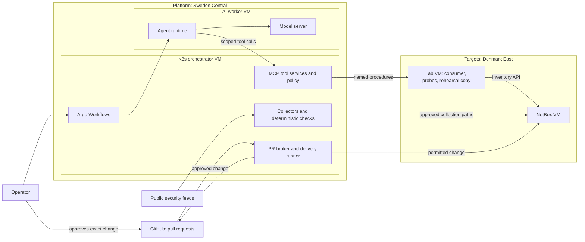

# Architecture

This document describes the planned system. Nothing in it is deployed yet. Each section states what is decided, what is proposed, and what is still open.

Decisions with their context and trade-offs are in the [decision records](decisions/README.md). Milestones are in the [roadmap](roadmap.md).

## Purpose

The platform investigates security findings on a service it does not host, and proposes fixes that have been tested before a human sees them.

- Deterministic tools collect evidence and establish facts: configured access, observed reachability, deployed versions.
- AI workers interpret the evidence, request more through narrow tools, and propose a bounded change.
- A trusted runner rehearses the change on a disposable copy of the target.
- A pull request carries the change and its evidence. The operator approves it.
- A trusted delivery step applies the approved change and fresh collection verifies the result.

The project is infrastructure work: Terraform, Kubernetes operations, model hosting, identity, networking, isolation, and operational drills. Existing software provides the workflow engine, agent runtime, and user interfaces. Custom code is limited to small collectors, adapters, and enforcement checks.

## System overview



The AI worker VM has no network path to the target region. Everything it learns about the target arrives through tool services on the orchestrator.

## Platform and target separation

The platform and the targets are separate infrastructure. They share one Azure subscription and nothing else. See [ADR 0002](decisions/0002-separate-platform-and-target-infrastructure.md).

| Aspect | Platform | Targets |
| --- | --- | --- |
| Purpose | Runs orchestration, tools, AI workers, inference | Hosts the service under investigation and its lab fixtures |
| Region | Sweden Central | Denmark East |
| Terraform root | `infra/platform/` | `infra/targets/` |
| Terraform state | Own storage account, own access scope | Own storage account, own access scope |
| Resource groups | Platform only | Targets only |
| Virtual network | `10.40.0.0/20` | `10.50.0.0/20` |
| Deployment identity | Platform scope only | Target scope only |
| Lifecycle | Long-lived | Rebuilt and reseeded per exercise |
| Intentional weaknesses | None | Seeded per exercise, inside outer containment |

Folder layout is organization. The boundary is enforced by state permissions, role assignments, network rules, and separate credentials.

Two rules follow from the separation:

- **Target changes never touch the platform.** A remediation proposal can modify allowlisted target fields only. Platform Terraform, policies, workflows, and CI are outside its scope.
- **Containment is not a target setting.** The rules that keep the lab private are owned by the platform side of the boundary and cannot be removed by a target change, including an approved one.

## Network

### Address plan

Proposed. No existing networks conflict with it.

| Range | Region | Use |
| --- | --- | --- |
| `10.40.0.0/20` | Sweden Central | Platform virtual network |
| `10.40.0.0/27` | Sweden Central | Orchestrator subnet |
| `10.40.0.32/27` | Sweden Central | AI worker subnet |
| `10.40.1.0/26` | Sweden Central | Reserved: administrative access |
| `10.50.0.0/20` | Denmark East | Target virtual network |
| `10.50.0.0/27` | Denmark East | NetBox subnet |
| `10.50.0.32/27` | Denmark East | Authorized consumer viewpoint |
| `10.50.0.64/27` | Denmark East | Unintended viewpoint (exercise 2) |
| `10.50.1.0/27` | Denmark East | Rehearsal copy |
| `10.42.0.0/16`, `10.43.0.0/16` | In cluster | K3s default pod and service ranges, not routed between networks |

### Connectivity

Global virtual network peering connects the two networks. Peering provides routing, not filtering. Network security groups on both sides deny by default and allow only the flows below.

| Source | Destination | Purpose | State |
| --- | --- | --- | --- |
| Orchestrator subnet | NetBox subnet | Evidence collection, approved delivery | Allowed, fixed ports |
| Orchestrator subnet | Viewpoint and rehearsal subnets | Start named probes and rehearsals | Allowed, fixed ports |
| Orchestrator subnet | AI worker subnet | Dispatch jobs | Allowed |
| AI worker subnet | Orchestrator subnet | Tool services only | Allowed, fixed ports |
| AI worker subnet | Target network | None | Denied |
| AI worker subnet | Internet | None after model and image provisioning | Denied |
| Target network | Platform network | None | Denied for new connections |
| Internet | Any | None | Denied inbound |

Application authentication and TLS are required on allowed flows. A permitted route is not authorization.

Open items: the administrative access method, the egress design for package and image downloads, and private DNS. See [Open decisions](#open-decisions).

## Platform

### Orchestrator

A single K3s server on one VM runs the trusted components. See [ADR 0001](decisions/0001-k3s-for-initial-orchestration.md).

| Namespace | Workloads | Responsibility |
| --- | --- | --- |
| `orchestration` | Argo Workflows controller and server, fixed workflow templates | Scheduling, retries, concurrency limits, operator UI |
| `collection` | Collectors and deterministic checks | Read approved sources, correlate advisories locally |
| `tool-services` | Narrow MCP servers and the policy check | Validate caller, job, target, operation, and arguments on every call |
| `change` | PR broker and delivery runner | Publish permitted patches, apply approved changes |
| `observability` | Metrics and logs, sized after measurement | Operational and audit visibility without private payloads |

Namespaces organize workloads. They are not treated as a boundary against malicious code.

### AI worker

A second VM runs the agent runtime and the model server. It is not a Kubernetes node. See [ADR 0005](decisions/0005-ai-workers-on-a-separate-vm.md).

- The worker holds no delivery credentials, no repository credentials, and no cloud identity with privileges.
- Each job gets a scoped session: one target, one evidence set, bounded time and output.
- The worker reaches tool services on the orchestrator and nothing else.
- Argo does not dispatch to an external VM by itself. The dispatch mechanism is an open decision and the first integration risk.

### Candidate components

These are candidates to validate, not final selections.

| Role | Candidate | To validate |
| --- | --- | --- |
| Workflow engine and UI | Argo Workflows | Dispatch to the worker VM, restart recovery, footprint |
| Agent runtime | Goose | Headless runs, restricted tool set, private model endpoint |
| Model server | llama.cpp | Tool-call format, memory, throughput on the chosen VM size |
| Starting model | Qwen3-4B-Instruct-2507, quantized | Structured output and tool calling on held-out fixtures |
| Model gateway | LiteLLM | Whether it earns its footprint while there is one model backend |
| Deterministic checks | Trivy, Checkov, Nmap, OPA | Coverage for the selected exercises |
| Metrics and dashboards | Prometheus, Grafana | Footprint on the orchestrator |

## Targets

The first target is NetBox with synthetic inventory. See [ADR 0004](decisions/0004-netbox-as-first-target.md).

| Fixture | Role |
| --- | --- |
| NetBox VM | The protected service: NetBox, its database, cache, and worker, deployed from pinned container images |
| Authorized consumer | Reads a defined inventory subset through the REST API with a read-only token |
| Unintended viewpoint | A controlled source that policy says must not reach NetBox |
| Rehearsal copy | A disposable NetBox with separate synthetic data and credentials |

The consumer, the viewpoints, and the rehearsal copy share one lab VM, with one network interface per viewpoint subnet. This is a capacity decision, described under [Capacity](#capacity).

NetBox is the subject of investigation. It never supplies the platform's target registry, permissions, or approval policy.

### Exercises

Three exercises run in this order on the same service and the same consumer contract.

| Order | Finding | Correct outcome | Change surface |
| --- | --- | --- | --- |
| 1 | The consumer can read inventory outside its approved scope | Required reads still work, other records are unavailable | NetBox permission configuration |
| 2 | NetBox is reachable from the unintended viewpoint | The consumer keeps access, the unintended source is blocked | Target network rules |
| 3 | A pinned image or dependency is affected by a real public advisory | A vetted update removes the condition and preserves data and the consumer contract | Pinned image definition and update procedure |

A fix that locks out the legitimate consumer fails. Validation checks returned inventory content, not only a health endpoint.

## Workflow

1. Scheduled or operator-triggered collection produces validated evidence snapshots.
2. Deterministic checks establish configured access, observed reachability, and candidate findings.
3. A workflow fixes the job scope: target, evidence, tools, time and output limits.
4. An AI worker investigates and requests more evidence through tool services.
5. The worker proposes a change limited to allowlisted fields or a vetted procedure.
6. A trusted runner rehearses the change on the rehearsal copy and runs fixed tests.
7. The broker opens a pull request with the change, evidence, and stated uncertainty.
8. The operator approves the exact commit and target.
9. The delivery runner re-checks policy and applies the change.
10. Fresh collection verifies the outcome. Cleanup retires the session and temporary resources.

Models explain and propose. Tools establish facts. Neither a model's confidence nor a passing test authorizes a change.

## Trust boundaries

| Component | Trust | Reason |
| --- | --- | --- |
| Cloud provider, platform administrator | Trusted | Accepted baseline. A privileged provider compromise is a documented residual risk, not a mitigated one |
| Orchestrator and its workflow templates | Trusted | Fixed, reviewed, not writable by workers |
| AI worker, model output | Untrusted | Assumed compromisable. Limited by network, credentials, and tool-side checks |
| Target, guest reports, API responses | Untrusted | A compromised target can forge its own evidence |
| Advisories, tool results, proposed patches | Untrusted input | Can carry instructions or unsafe changes |

Controls that follow:

- Every tool call is authorized on the server side by caller identity, job scope, target, operation, and arguments. Tool visibility is not authorization.
- Evidence from the target is compared with repository, cloud, and network observations. Disagreement is recorded, not resolved by the model.
- Approval binds to a commit and a target. A changed proposal needs new checks and new approval.
- Private payloads stay in protected storage. Workflow parameters and logs carry references.
- The repository is public. Pull requests carry synthetic data and sanitized summaries only. State, raw plans, and secrets never enter them.

## Identity

- **Operator:** Microsoft Entra ID sign-in through supported OIDC integrations. The design assumes no premium identity features. One operator investigates and approves, which does not demonstrate separation of duties between people.
- **Workloads:** collector, tool service, broker, delivery runner, and worker have separate permissions. Delivery and repository credentials live only in the `change` namespace.
- **Cloud access from K3s:** open. Workload identity federation on a self-managed cluster needs a publicly reachable OIDC issuer document. A VM managed identity is reachable by every process on that VM. The choice is recorded in a decision record before any workload gets cloud access.

## Capacity

The subscription allows 4 vCPUs per region and has no GPU quota. The design treats both as fixed. Quota counts deallocated VMs too, so the budget is about VMs that exist, not VMs that run. Evidence is in the [preflight worklog](worklogs/0000-azure-preflight.md).

| Region | VM | vCPUs | Candidate size |
| --- | --- | --- | --- |
| Sweden Central | Orchestrator | 2 | `Standard_B2as_v2` or `Standard_D2as_v5` (8 GB) |
| Sweden Central | AI worker | 2 | `Standard_D2ps_v6` (Arm, 2 physical cores, 8 GB) or `Standard_D2as_v5` |
| Denmark East | NetBox | 2 | `Standard_B2as_v2` (8 GB) |
| Denmark East | Lab | 2 | `Standard_B2as_v2` (8 GB) |

Sizes are candidates until measured. Known pressure points:

- A 2-vCPU x64 size is one physical core. Arm sizes give two cores per 2 vCPUs but need arm64 builds of everything on the worker.
- The orchestrator carries K3s, Argo, collectors, tool services, and the change components. Observability and the model gateway are added only if measurement shows room.
- The initial design runs one investigation at a time with one loaded model.

## Repository layout

Planned. Directories are created by the milestone that needs them.

```text
infra/platform/     Platform Terraform root
infra/targets/      Target Terraform root
platform/           K3s component configuration and workflow templates
targets/netbox/     NetBox deployment definition, fixtures, consumer contract
policies/           Target, tool, and change rules
collectors/         Collection and adaptation scripts
validation/         Contract tests and security and recovery drills
docs/               Architecture, decisions, troubleshooting, worklogs
```

## Open decisions

Each is resolved in a decision record before the milestone that depends on it.

| Decision | Needed before |
| --- | --- |
| Administrative access to private VMs | Platform compute |
| Egress design for image and package downloads | Platform compute |
| Dispatch from Argo to the worker VM | Toolchain integration |
| Cloud identity for K3s workloads | Toolchain integration |
| Worker execution isolation beyond VM separation | Connecting real target evidence |
| NetBox version, consumer scope, seeded settings | Target deployment |
| GitHub App permissions and approval enforcement | Remediation and pull requests |
| Acceptance thresholds for quality, recovery, and cost | Operational drills |

## Limitations

- Single-node K3s and single VMs. No high availability.
- CPU inference with a small model proves integration. It does not prove investigation quality or throughput.
- One operator. No multi-user access model.
- VM separation limits a compromised worker's reach. It is not a claim of protection against host or provider compromise.
