# Architecture

This page describes the current system and its planned design. The network foundation and platform VMs are deployed: state storage, deployment identities, both virtual networks, security groups, peering, the NAT gateway, the orchestrator with the mesh VPN and K3s, and the AI worker.

The model server and agent runtime run on the worker. The agent has only used a local test tool. The tool service runs in K3s on the orchestrator, and has answered tool calls from the worker made with `curl` and a job token. Automated job dispatch and all targets are still planned. Each section distinguishes implemented controls, decisions, and open work.

The reasoning behind each choice is in the [decision records](decisions/README.md). The order of work is in the [roadmap](roadmap.md).

## Purpose

Finding a misconfiguration is only the start. The real work is proposing a fix that removes the problem without breaking the people who depend on the service, and proving that before anyone approves it.

That is what this platform does, for a service it does not host:

- Tools collect evidence and establish facts: configured access, observed reachability, deployed versions.
- AI workers read the evidence, ask for more through narrow tools, and propose a change within defined limits.
- A trusted runner rehearses the change on a disposable copy of the target.
- A pull request carries the change and its evidence to the operator.
- After approval, a trusted delivery step applies it, and fresh collection checks the result.

This is an infrastructure project. The work is Terraform, Kubernetes operations, model hosting, identity, networking, isolation, and drills. Existing software supplies the workflow engine, the agent runtime, and the user interfaces. Custom code stays small: collectors, adapters, and enforcement checks.

## System overview



Note the dotted line from the AI worker: it ends at a stop bar. The worker cannot reach the target region at all. Everything it knows about the target, it was handed by a tool service on the orchestrator.

The orchestrator box hides four groups of components. They are listed under [Orchestrator](#orchestrator), and the order they act in is under [Workflow](#workflow).

## Platform and target separation

The platform holds the credentials and rules that decide what may change. The target is deliberately weak and gets rebuilt often. Putting them in the same Terraform configuration, network, or permission scope would let a mistake in one reach the other.

They share an Azure subscription, with separate Terraform roots, state, resource groups, networks, and deployment identities. See [ADR 0002](decisions/0002-separate-platform-and-target-infrastructure.md).

| Aspect | Platform | Targets |
| --- | --- | --- |
| Purpose | Orchestration, tools, AI workers, inference | The service under investigation and its lab fixtures |
| Region | Sweden Central | Denmark East. Moves to Poland Central in [milestone 3a](roadmap.md#3a-edge-network-and-monitoring) ([ADR 0020](decisions/0020-an-edge-vm-for-the-way-out-and-the-mesh.md)) |
| Terraform root | `infra/platform/` | `infra/targets/` |
| Terraform state | Own storage account, own access scope | Own storage account, own access scope |
| Resource groups | `rg-aisec-platform`, `rg-aisec-platform-state` | `rg-aisec-targets`, `rg-aisec-targets-state` |
| Virtual network | `10.40.0.0/20` | `10.50.0.0/20` |
| Deployment identity | `aisec-platform-deploy`, platform scope only | `aisec-targets-deploy`, target scope only |
| Lifecycle | Long-lived | Rebuilt and reseeded per exercise |
| Intentional weaknesses | None | Seeded per exercise, inside outer containment |



Separate folders prove nothing. The boundary is real only where state permissions, role assignments, network rules, and separate credentials enforce it.

That has been tested. Each deployment identity was denied every read and write it tried on the other side's network, resource group, and state. See the [network foundation worklog](worklogs/0001-network-foundation.md#identity-separation).

A third root, `infra/bootstrap`, sits above both. The operator runs it, and it owns what a scoped identity cannot create for itself: the resource groups, the state accounts, the identities, and their role assignments. Each identity authenticates with a certificate whose private key never enters Terraform. See [ADR 0008](decisions/0008-deployment-identities-and-bootstrap-scope.md).

The boundary has one deliberate hole. Each identity may name the other side's network as a peering partner, through a custom role with that single action. It cannot read or change that network.

Two rules follow:

- **A target change never touches the platform.** A remediation can modify allowlisted target fields. Platform Terraform, policies, workflows, and CI are out of its reach.
- **Containment is not a target setting.** The rules that keep the lab private belong to the platform side. No target change can remove them, approved or not.

## Network

### Address plan

Deployed. Every subnet has its own network security group and no default outbound access.

| Range | Region | Use |
| --- | --- | --- |
| `10.40.0.0/20` | Sweden Central | Platform virtual network |
| `10.40.0.0/27` | Sweden Central | Orchestrator subnet |
| `10.40.0.32/27` | Sweden Central | AI worker subnet |
| `10.50.0.0/20` | Denmark East | Target virtual network |
| `10.50.0.0/27` | Denmark East | NetBox subnet |
| `10.50.0.32/27` | Denmark East | Authorized consumer viewpoint |
| `10.50.0.64/27` | Denmark East | Unintended viewpoint (exercise 2) |
| `10.50.1.0/27` | Denmark East | Rehearsal copy |
| `10.42.0.0/16`, `10.43.0.0/16` | In cluster | K3s default pod and service ranges, never routed between networks |

Decided for [milestone 3a](roadmap.md#3a-edge-network-and-monitoring), not built: an edge network, `10.45.0.0/24` in Denmark East, with the edge at `10.45.0.4` and the router at `10.45.0.36` ([ADR 0020](decisions/0020-an-edge-vm-for-the-way-out-and-the-mesh.md), [ADR 0025](decisions/0025-the-mesh-node-on-its-own-vm.md)). A private endpoint subnet for monitoring, `10.40.0.64/27` ([ADR 0021](decisions/0021-monitoring-in-azure-monitor-over-private-link.md)). The target network keeps its ranges and moves to Poland Central.

### Connectivity

Global virtual network peering joins the two networks. Peering is plumbing, not a filter: once it exists, everything can route to everything. Network security groups on both sides deny by default and allow only what is listed here.

Each security group ends in a deny-all rule in both directions at priority 4096. That rule is the point: Azure's built-in rules allow everything inside the `VirtualNetwork` tag, and peering puts the other network inside that tag.

The table is the design. Rules exist for what is built: SSH from the orchestrator subnet to the worker and to the target network, the package proxy and tool service ports from the worker to the orchestrator, and outbound internet access from the orchestrator. The other allowed flows get their rules with the service that listens on them. The denied flows are enforced now.

| Source | Destination | Purpose | State |
| --- | --- | --- | --- |
| Orchestrator subnet | NetBox subnet | Evidence collection, approved delivery | Allowed, fixed ports |
| Orchestrator subnet | Viewpoint and rehearsal subnets | Start named probes and rehearsals | Allowed, fixed ports |
| Orchestrator subnet | AI worker subnet | Artifact transfer now; job dispatch planned. Both use SSH | Allowed, TCP 22 |
| AI worker subnet | Orchestrator subnet | The package proxy and the tool service, both built | Allowed, fixed ports: TCP 3128 and 30443 |
| AI worker subnet | Target network | None | Denied, by an explicit rule on the platform side |
| AI worker subnet | Internet | None. The orchestrator pushes what the worker needs | Denied, by an explicit rule on the platform side |
| Orchestrator subnet | Internet | Mesh VPN, downloads, security feeds, GitHub | Allowed, through the NAT gateway: TCP 443 and 80 ([ADR 0017](decisions/0017-no-udp-from-the-orchestrator.md)) |
| Target network | Internet | None. The orchestrator pushes what the targets need | Denied, by explicit rules and by a policy that refuses public IP resources on the target side |
| Target network | Platform network | None | Denied for new connections, by an explicit rule on the platform side |
| Operator device | Orchestrator, then other VMs | Administration over the mesh VPN | Allowed for the operator's signed devices, on SSH and the Kubernetes API |
| Internet | Any | None | Denied inbound |

An allowed route is not authorization. Every allowed flow still needs application authentication and TLS.

### Administrative access

No VM has a public address. The operator gets in over a mesh VPN: the orchestrator runs the agent and routes to both networks. No firewall rule names an operator address, because none is needed. Detail: [mesh VPN](components/mesh-vpn.md).

On both VMs since 2026-10-16, the administrator account takes only an SSH certificate that expires after 12 hours ([ADR 0022](decisions/0022-short-lived-ssh-certificates-for-the-operator.md), [worklog](worklogs/0004-edge-network-and-monitoring.md#rollout-1)). The orchestrator's feed key logs in to an account of its own on the worker, which can only unpack staged files ([ADR 0026](decisions/0026-the-feed-key-gets-its-own-account-on-the-worker.md)). Decided for milestone 3a, not built: the agent moves to a router VM that no subnet can reach ([ADR 0025](decisions/0025-the-mesh-node-on-its-own-vm.md)).

### Egress

The system has one outbound path to the internet: a NAT gateway on the orchestrator subnet. The orchestrator is the only machine that downloads anything. The worker and the targets get their software from the orchestrator, and three controls block their outbound access, because any one alone leaves a path open: no outbound method, explicit deny rules, and Azure Policy assigned outside both roots.

The worker has one exception: a proxy on the orchestrator that forwards package downloads to two hosts. The targets do not get it.

Detail: [egress and policy](components/egress-and-policy.md), [package proxy](components/package-proxy.md).

Decided for milestone 3a, not built: the NAT gateway and the package proxy move to an edge VM, and the orchestrator reaches the internet only through that proxy, with a short list of hosts and a fetch window the operator opens for builds ([ADR 0020](decisions/0020-an-edge-vm-for-the-way-out-and-the-mesh.md)).

## Platform

### Orchestrator

One K3s server on one VM runs everything that is trusted. It also routes for the mesh VPN and serves the worker's package proxy. Detail: [orchestrator](components/orchestrator.md), [K3s](components/k3s.md).

### AI worker

The agent runtime and the model server run on a second VM that is not part of the cluster. The worker reads advisories, target evidence, and tool output. Any of those can carry malicious instructions. The design assumes the worker can be compromised and restricts its access:

- No delivery credentials, no repository credentials, no privileged cloud identity.
- One scoped session per job: one target, one evidence set, bounded time and output.
- One network destination for work: the tool services on the orchestrator.

The cost is dispatch. Argo runs pods, not processes on another machine. A workflow step opens an SSH session to the worker with a key that can only run the job runner. Decided in [ADR 0012](decisions/0012-dispatch-over-ssh-with-a-forced-command.md), not built, and still the first real integration risk. Detail: [AI worker](components/ai-worker.md).

What exists today is narrower than the design. The agent is started manually and uses one local test tool on the worker. The tool service that replaces the fixture runs on the orchestrator. The worker has called it with `curl`, not yet with the agent. See the [milestone 3 worklog](worklogs/0003-toolchain-integration.md).

### Components

What is built, what is planned, and every version pin are in [components](components/README.md).

## Targets

The first target is NetBox with synthetic inventory. See [ADR 0004](decisions/0004-netbox-as-first-target.md).

| Fixture | Role |
| --- | --- |
| NetBox VM | The protected service: NetBox with its database, cache, and worker, from pinned container images |
| Authorized consumer | Reads a defined inventory subset through the REST API with a read-only token |
| Unintended viewpoint | A controlled source that policy says must not reach NetBox |
| Rehearsal copy | A disposable NetBox with its own synthetic data and credentials |

The consumer, both viewpoints, and the rehearsal copy share one lab VM, with one network interface per viewpoint subnet. That is a capacity compromise, explained under [Capacity](#capacity).

NetBox is the thing being investigated. It is never a source of truth for the platform. The platform's target registry, permissions, and approval policy do not come from anything NetBox returns.

### Exercises

Three exercises, in this order, on the same service and the same consumer contract.

| Order | Finding | Correct outcome | Change surface |
| --- | --- | --- | --- |
| 1 | The consumer can read inventory outside its approved scope | Required reads still work, other records are gone | NetBox permission configuration |
| 2 | NetBox is reachable from the unintended viewpoint | The consumer keeps access, the unintended source is blocked | Target network rules |
| 3 | A pinned image or dependency is affected by a real public advisory | A vetted update removes the condition and keeps data and the consumer contract intact | Pinned image definition and update procedure |

The easy way to pass a security check is to break the service. So a fix that locks out the legitimate consumer fails, and validation checks the inventory the consumer actually gets back, not a health endpoint.

## Workflow



1. Collection runs on a schedule or on request and produces validated evidence snapshots.
2. Deterministic checks establish configured access, observed reachability, and candidate findings.
3. A workflow fixes the job scope: target, evidence, tools, time and output limits.
4. An AI worker investigates and asks for more evidence through tool services.
5. The worker proposes a change, limited to allowlisted fields or a vetted procedure.
6. A trusted runner rehearses the change on the rehearsal copy and runs fixed tests.
7. The broker opens a pull request with the change, the evidence, and what remains uncertain.
8. The operator approves the exact commit and target.
9. The delivery runner re-checks policy and applies the change.
10. Fresh collection verifies the outcome. Cleanup retires the session and temporary resources.

Models explain and propose. Tools establish facts. A confident model does not authorize a change, and neither does a green test.

## Trust boundaries

| Component | Trust | Reason |
| --- | --- | --- |
| Cloud provider, platform administrator | Trusted | Accepted baseline. A privileged provider compromise is a risk this design documents and does not mitigate |
| Orchestrator and its workflow templates | Trusted | Fixed, and not writable by workers |
| AI worker, model output | Untrusted | Assumed compromisable. Limited by network, credentials, and tool-side checks |
| Target, guest reports, API responses | Untrusted | A compromised target can forge its own evidence |
| Advisories, tool results, proposed patches | Untrusted input | Can carry instructions or unsafe changes |

What follows from that:

- Every tool call is authorized on the server: caller, job scope, target, operation, arguments. Hiding a tool from the model is not access control.
- Target evidence is compared with what the repository, the cloud API, and the network say. When they disagree, the disagreement is recorded. The model does not get to pick a winner.
- Approval binds to a commit and a target. Change the proposal and the approval is void.
- Private payloads stay in protected storage. Workflow parameters and logs carry references.
- The repository is public. Pull requests carry synthetic data and sanitized summaries. State, raw plans, and secrets never enter them.

## Security practices

The method is in [ADR 0010](decisions/0010-threat-model-and-security-checks-per-milestone.md). The State column records implementation and validation evidence.

The table above says who is trusted. The [threat model](security/threat-model.md) says what can go wrong at each boundary, what stops it, and where that gets tested. Its first pass was written before any VM existed.

Everything else is attached to the milestone that builds the thing it checks. A practice without a gate has no check that it was done.

| Practice | What it covers | Lands with | State |
| --- | --- | --- | --- |
| Threat model | Threats per trust boundary, AI-specific threats, the control for each, residual risk, and the gap between this lab and production | Before platform compute, then updated with each decision | First pass written. States reviewed on 2026-10-14 and 2026-10-15 against the validation checks and repository settings, and moved on 2026-10-16 for ADRs 0020 to 0025 |
| Repository protection | Secret scanning with push protection, and a protected `main`. The repository is the approval channel, so this is a system control | Platform compute | Built. Secret scanning, push protection, and a ruleset on `main`. Required checks are documented in the [pipeline page](components/pipeline.md#repository-settings). Written: a check that every commit is signed by the operator's key, not yet required ([0024](decisions/0024-the-targets-in-their-own-repository-and-signed-commits.md)) |
| Static checks on pull requests | Terraform and manifest misconfigurations, leaked secrets. No cloud credentials in the pipeline | Platform compute | Built. The [pipeline page](components/pipeline.md#checks-on-every-pull-request) lists the checks and which are required |
| Dependency updates | Automated pull requests that move the version pins | Platform compute | Configured. No update has been proposed yet. From milestone 3a, each proposal is redone by the operator, because the [signature check](components/pipeline.md#the-signature-check) refuses commits GitHub signs |
| Hardening baselines | CIS benchmarks for the operating system and Kubernetes | Platform compute | Kubernetes benchmark run, one check accepted. The operating system has a Lynis audit with its findings triaged. No tool has a CIS profile for Ubuntu 26.04 yet, which is an accepted risk. Neither tool has been run again on the orchestrator that was rebuilt on 2026-10-13 |
| Credential inventory | Every secret: where it lives, what can read it, how it is rotated | Platform compute, then every milestone | Current. Each long-lived credential on the VMs rotated once, except the worker log export key and the SSH certificate authority key, both made on 2026-10-16. The dispatch SSH key is planned and has not been created. The worker log export key is in use since 2026-10-16 |
| Audit log | Every tool call with caller, job, and decision, out of the worker's reach | Toolchain integration | Verified for audit output: the live tool service printed one JSON entry per decision, with no token ([worklog](worklogs/0003-toolchain-integration.md#the-round-trip)). Verified for storage on 2026-10-16: a host unit copies the lines into an append-only file on the orchestrator, `L.1` to `L.7` pass, and each was seen to fail, on a broken condition or before the install ([worklog](worklogs/0003-toolchain-integration.md#rollout-of-the-log-copies)). Root on the orchestrator can still edit it ([audit log](security/audit-log.md)) |
| Supply chain | Digest pins, signature checks where upstream signs, an SBOM where an exercise needs one | Toolchain integration, target deployment, exercise 3 | Built for the model server: 38 inputs pinned by checksum and verified on the orchestrator ([worklog](worklogs/0003-toolchain-integration.md#download-and-verify)). Built for the agent runtime the same way, and for the tool service's 28 packages, which install by hash. The tool service image is pulled by digest, checked by `T.2`. No signature is checked, and there is no SBOM |
| Monitoring | Logs and alerts kept outside the machines they describe | Edge network and monitoring | Decided in [ADR 0021](decisions/0021-monitoring-in-azure-monitor-over-private-link.md): Azure Monitor over Private Link, alerts shown in the portal. Not built |
| Incident response runbook | A compromised worker or target, a leaked credential | Operational drills | Planned |

There is no compliance framework here. ISO 27001 and SOC 2 describe an organisation, and this one has a single operator.

## Identity

- **Operator:** Microsoft Entra ID sign-in through supported OIDC integrations, with no premium identity features assumed. One person investigates and approves. That is not separation of duties, and the project does not claim it is.
- **Workloads:** collector, tool service, broker, delivery runner, and worker each have their own permissions. Delivery and repository credentials exist only in the `change` namespace.
- **Jobs:** each job gets a random token at dispatch, scoped to one target and a list of tools, and revoked when the job ends. Decided in [ADR 0013](decisions/0013-a-token-per-job-and-no-cloud-identity-yet.md). The tool service registers jobs, validates tokens, and revokes jobs, tested on the live system. Token issuance is not implemented. Detail: [tool service and job identity](security/tool-service.md).
- **Cloud access from K3s:** none, and still open. Workload identity federation on a self-managed cluster needs publicly reachable OIDC issuer metadata and public signing keys, which can be hosted separately from the cluster. A VM managed identity is simpler but is available to every process on that VM. Toolchain integration needs no cloud access, so the choice waits for the first workload that does. See [ADR 0013](decisions/0013-a-token-per-job-and-no-cloud-identity-yet.md).

## Capacity

The subscription allows 4 vCPUs per region and has no GPU quota. Both are treated as fixed. Quota counts VMs that exist, not VMs that run, so deallocating a VM frees nothing. Evidence is in the [preflight worklog](worklogs/0000-azure-preflight.md).

That gives two VMs per region, with nothing to spare. The limit cannot be raised for this subscription type. [Milestone 3a](roadmap.md#3a-edge-network-and-monitoring) puts the edge and the router in Denmark East and moves the targets to Poland Central ([ADR 0020](decisions/0020-an-edge-vm-for-the-way-out-and-the-mesh.md), [ADR 0025](decisions/0025-the-mesh-node-on-its-own-vm.md)). The table shows today's placement.

| Region | VM | vCPUs | Size | State |
| --- | --- | --- | --- | --- |
| Sweden Central | Orchestrator | 2 | `Standard_B2as_v2` (8 GB) | Built. The regional quota is full |
| Sweden Central | AI worker | 2 | `Standard_D2ps_v6` (Arm, 2 physical cores, 8 GB) | Built |
| Denmark East | NetBox | 2 | `Standard_B2as_v2` (8 GB), candidate | Planned |
| Denmark East | Lab | 2 | `Standard_B2as_v2` (8 GB), candidate | Planned |

Idle use of the two built VMs is on their [component pages](components/README.md). Where it will hurt:

- **Inference.** Two x64 vCPUs are one physical core. Arm sizes give two real cores for the same quota, at the price of arm64 builds for everything on the worker.
- **The orchestrator.** It carries K3s, Argo, collectors, tool services, and the change components. The model gateway goes in only if measurement shows room. Planned for [milestone 3a](roadmap.md#3a-edge-network-and-monitoring): monitoring in Azure Monitor, so the orchestrator carries only a log agent.
- **Concurrency.** One investigation at a time, one loaded model.

## Repository layout

`.github/`, `infra/`, `platform/`, `worker/`, `tool-service/`, `policies/`, `validation/`, and `docs/` exist. Every other directory appears with the milestone that needs it.

```text
.github/            Static checks on pull requests, dependency update configuration
infra/bootstrap/    Operator-run root: resource groups, state accounts, deployment identities
infra/modules/      Shared Terraform modules
infra/platform/     Platform Terraform root
infra/targets/      Target Terraform root. Moves to the targets repository in milestone 3a (ADR 0024)
platform/           What the orchestrator runs: K3s manifests and the log copiers today, workflow templates later
worker/             What the orchestrator copies to the AI worker: pins, build scripts, service units
tool-service/       The MCP server that checks every tool call, its tests, and its pinned packages
targets/netbox/     Not in this repository. NetBox, its fixtures, and the consumer contract go in the targets repository (ADR 0024)
policies/           Target, tool, and change rules. Today: the tool service's
collectors/         Collection and adaptation scripts
validation/         Checks against the running system. Contract tests and drills come later
docs/               Architecture, components, decisions, diagrams, runbooks, security, troubleshooting, validation, worklogs
```

## Open decisions

Each gets a decision record before the milestone that depends on it.

| Decision | Needed before |
| --- | --- |
| Cloud identity for K3s workloads | Target deployment |
| Worker isolation beyond VM separation | Connecting real target evidence |
| NetBox version, consumer scope, seeded settings | Target deployment |
| How the targets get packages and stay current. [ADR 0011](decisions/0011-package-proxy-for-the-worker.md) left it open | Target deployment |
| GitHub App permissions and approval enforcement | Remediation and pull requests |
| Acceptance thresholds for quality, recovery, and cost | Operational drills |

## Limitations

- One K3s node and single VMs. A VM failure stops that part of the system.
- A small model on CPU proves the integration works. It says little about investigation quality or speed.
- One operator. There is no multi-user access model, and nobody else reviews a change. Automated checks are the only second reader.
- A separate VM limits what a compromised worker can reach. It does nothing against a compromised host or provider.
- Both roots use the same network module. A change to it reaches both sides, so the separation is in state, identity, and network rules, not in the code.
- The public address policy leaves one gap on the platform side. It refuses a public address on a network interface in both resource groups, and any public IP resource on the target side. Both are assigned from the bootstrap root and [validated](worklogs/0002-platform-compute.md#public-address-policy). The platform identity can still create a public IP resource in its own group, because the NAT gateway needs one. It cannot attach it to a machine.
- The orchestrator's egress is not filtered by hostname. It can reach any host on TCP 443 and 80. [ADR 0020](decisions/0020-an-edge-vm-for-the-way-out-and-the-mesh.md) moves it behind a proxy on an edge VM in milestone 3a.
- The [threat model](security/threat-model.md) is a first pass, written by the designer. The controls on the network, the VMs, and the repository are verified or built. Most of the rest are written, decided, or planned, and its [open items](security/accepted-risks.md#open-items) have no answer yet.
