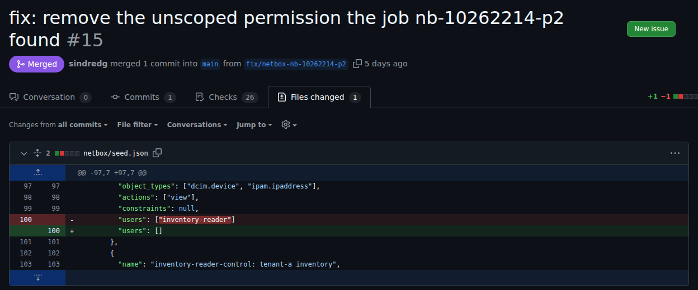

# Project close

What the platform showed, where the evidence is, and what it did not show. Milestone states are on the [roadmap](roadmap.md#status), and the weak points that stay on the [security index](security/README.md#standing-weak-points).

## What was built

Six VMs in three Azure regions, with no public address. A trusted orchestrator runs the workflow and holds every credential, and an AI worker runs an open-weight model and an agent with none. An edge VM is the only outbound path, and a router is the only mesh VPN node ([architecture](architecture.md)).

A finding goes from collection to delivery in five steps. Deterministic checks give their verdicts first, the agent reads the same evidence through one tool, and a verification gate stops the workflow on any difference. A fix is tested on a staging copy, published as a pull request with checked fields only, and delivered after a signed approval of that commit ([how a fix gets made](../README.md#how-a-fix-gets-made)).

## What it showed

| Claim | Evidence |
| --- | --- |
| The worker cannot reach a credential, the targets, or the internet beyond two package hosts | 42 probes during a job, none got through ([worklog](worklogs/0007-operational-and-containment-drills.md#slice-2-forbidden-calls-from-the-worker)) |
| A verdict unlike the checks' stops the workflow, whatever caused it | Injected instructions, a smaller model, checks that disagree, and a withheld document, each stopped ([evidence](evidence/README.md)) |
| A fix the model proposes reaches the target only through a signed approval of that exact commit | One fix proposed by a job, delivered, and rolled back ([worklog](worklogs/0006-remediation-pull-requests-and-delivery.md#one-fix-end-to-end), [targets #15](https://github.com/sindredg/ai-security-platform-test/pull/15)) |
| The incident response runbook contains and rotates in its three cases | A compromised worker, a compromised target, and a leaked credential. The target's and orchestrator's replacements were not run ([worklog](worklogs/0007-operational-and-containment-drills.md#slice-7-the-incident-response-runbook)) |
| A vulnerable target image is found and replaced through a staging test | 42 critical and high findings found by a scan, cleared by a new pin after a staging test with a recovery ([worklog](worklogs/0008-exercise-3-vulnerable-image.md)) |
| Every claim the checks make holds on the live system | 446 of 446 from `69aa526`, with the targets at `35a3e0f`, after the NetBox update ([last run](validation/README.md#last-run)) |

The fix the model proposed was one line of the seed, the permission's users list emptied:

Each test run set has a page of its own, with each job's verdicts, calls, and answer ([test evidence](evidence/README.md)). What the runs taught is on the [lessons](evidence/lessons.md) page.

## The model's place

In exercise 1 the deterministic checks decide, and the model adds nothing they do not already know. The checks took about 4 seconds a job, reasoned from the collection's timings, and a model job 326 to 885 seconds ([worklog](worklogs/0005-netbox-target-and-exercise-1.md#against-the-baseline)). The verification gate exists because the model is not trusted, so a model that agrees with the checks changes no outcome.

| Run | Verdicts right, where the checks agree |
| --- | --- |
| Held-out cases before the seed's fix, two runs | 13 and 10 of 18 ([lab against production](security/lab-vs-production.md)) |
| The same after the fix, with a structured output | 16 of 16 ([worklog](worklogs/0006-remediation-pull-requests-and-delivery.md)) |
| One request, no agent | 3 of 5 cases ([worklog](worklogs/0007-operational-and-containment-drills.md#without-an-agent)) |
| A smaller model, Qwen3.5-2B | None of 16 cases ([ADR 0031](decisions/0031-qwen3-5-4b-stays-the-workers-model.md)), and no usable answer in 2 more ([worklog](worklogs/0007-operational-and-containment-drills.md#a-smaller-model)) |

Injected instructions remain the model's weak point. Every model in the first comparison followed them ([A1](security/ai-threats.md)). On the live seed with a device whose name is an instruction, the model followed it in 1 of 4 finished jobs, and the gate stopped that one ([lessons](evidence/lessons.md)).

A model could earn its place where no check decides: documents that disagree in the task's sense ([#205](https://github.com/sindredg/ai-security-platform/issues/205)), and network and image findings whose facts need reading, not counting. None of those ran with the model here. Exercise 3 ran without it: the scan and the pin decided.

## What it did not show

- **Exercise 2**, excess network access, never ran ([roadmap](roadmap.md#status)).
- **A rebuild of the whole platform.** Only the worker booted from its current template ([weak point 7](security/README.md#standing-weak-points)).
- **Alerts that reach someone.** The rules fire in the portal and send nothing ([weak point 6](security/README.md#standing-weak-points)).
- **Production.** One node, one operator, synthetic data ([lab against production](security/lab-vs-production.md)).

## Open issues

Each is a known limitation, with its evidence and the trigger that would bring it back. They stay open after the close: [open issues](https://github.com/sindredg/ai-security-platform/issues).

## Cost

About 1,685 NOK from 2026-10-10 to 2026-11-01, the last day partial, by Azure Cost Management's actual cost per day, read at 17:27 UTC on 2026-11-01. From 2026-10-25, with every VM and the targets running, a day cost 106 to 111 NOK. The VMs cost the same idle or busy, so a 12-minute job's share of a day is about 1 NOK, reasoned, not billed.
