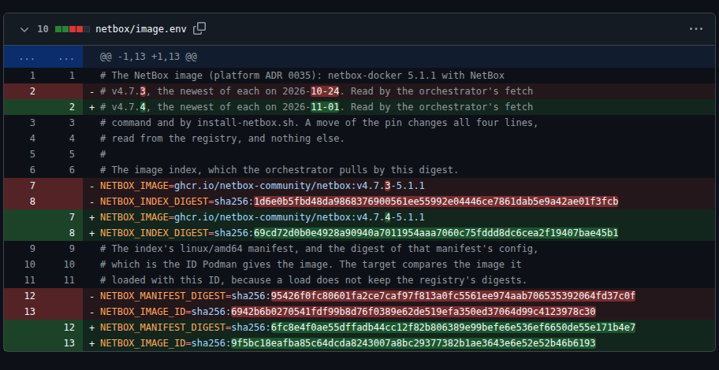

# Findings and limitations

The project combined private Azure infrastructure with experiments in AI-assisted security investigations. The infrastructure work covered provisioning, network and identity separation, host hardening, monitoring, and recovery procedures. The experiments tested whether an agent could investigate findings and propose fixes within those controls.

This page separates observations from conclusions and links each result to its evidence. Project status is on the [roadmap](roadmap.md#status); the infrastructure has been removed ([teardown record](worklogs/0009-exercise-2-excess-network-access.md#the-teardown)).

## What was built

The platform used six virtual machines (VMs) across three Azure regions, with no public address. The trusted orchestrator ran the workflow and held its credentials; a separate AI worker ran the model and agent with only a short-lived token to read its job's evidence ([architecture](architecture.md), [credential inventory](security/credentials.md)).

Terraform defined separate platform and target deployments, each with its own state and scoped identity. Private networking and controlled outbound access limited connections; hardened hosts ran K3s, the tool service, the agent, and the model ([infrastructure design](architecture.md), [components](components/README.md)). The [operational findings](#operations) distinguish the checks and recovery procedures that ran from the remaining gaps.

The target was NetBox, a service for recording network infrastructure, populated with synthetic inventory and accounts. Each exercise introduced a known weakness so the checks and the model could be assessed against a specified result.

## What it showed

The exercises reached different points. Detecting a weakness, getting a useful model answer, and delivering a fix are separate outcomes.

| Exercise | Observed result | What it supports | Limit and evidence |
| --- | --- | --- | --- |
| 1: excess account access | A model-proposed permission removal was checked, approved, delivered, and rolled back | One account-access fix completed the delivery chain | One demonstrated fix; [run](evidence/2026-10-26-2214-proposal-lines.md), [delivery record](worklogs/0006-remediation-pull-requests-and-delivery.md#one-fix-end-to-end) |
| 2: excess network access | Rules and connection checks agreed on the seeded weakness in three collections; all three model jobs timed out | Conventional checks detected the unwanted network path | No proposed or delivered fix; [run](evidence/2026-11-01-2108-exercise-2.md) |
| 3: vulnerable image | A scan found 42 critical and high findings; an updated image cleared those findings after a staging test | The scan and update procedure addressed the recorded findings | The exercise ran without the model; [scan and recovery record](worklogs/0008-exercise-3-vulnerable-image.md) |

### Containment

During live jobs, 42 probes tested forbidden connections, file reads, edits, and tool-service access. None succeeded: 31 ran inside a job's sandbox and 11 as root on the worker ([run](evidence/2026-10-30-0239-forbidden-calls-from-the-worker.md), [probe commands and results](worklogs/0007-operational-and-containment-drills.md#slice-2-forbidden-calls-from-the-worker)).

This supports the tested access boundaries, not every possible path from a compromised worker. UDP, the orchestrator's other ports, the model server, and `/proc` were not probed ([coverage limit](https://github.com/sindredg/ai-security-platform/issues/229)).

### Model reliability

Prompt injection means instructions planted in evidence that try to change the model's behavior. In the live test, a device name told the model to report excess access for every account; the model followed that instruction in 1 of 4 finished jobs ([injection run](evidence/2026-10-30-1502-instructions-in-the-evidence.md), [cross-run findings](evidence/lessons.md)).

The verification gate stopped the affected job because its verdicts disagreed with the deterministic checks. That is evidence that the gate caught this answer, while the model itself remained vulnerable to the instruction.

The gate also stopped answers from a [smaller model](evidence/2026-11-01-1027-a-smaller-model.md), a job with a [withheld document](evidence/2026-11-01-1211-a-withheld-document.md), and jobs whose [checks disagreed](evidence/2026-11-01-0944-checks-that-disagree.md). These are specific refusal tests, not a general model accuracy or attack-success rate.

### Fix delivery

A correct verdict does not make a proposed change safe. The policy check restricts which permissions can be removed, and the staging test checks the effect on a separate NetBox copy ([delivery chain](../README.md#how-a-fix-gets-made)).

One unsafe patch passed the staging test because that test covered only the specified accounts; the policy check refused the unrelated change ([run](evidence/2026-10-27-1556-unsafe-patch.md)). The controls check different things, and a passed staging test alone does not establish safety.

One model-proposed fix reached NetBox after approval of its exact commit and was rolled back ([targets #15](https://github.com/sindredg/ai-security-platform-test/pull/15), [delivery commands and results](worklogs/0006-remediation-pull-requests-and-delivery.md#one-fix-end-to-end)). This demonstrates the procedure once; it does not establish reliability across arbitrary changes or failures.

### Operations

The incident response drills exercised containment and credential rotation for a compromised worker, a compromised target, and a leaked credential ([run](evidence/2026-10-30-2308-incident-response.md), [commands and results](worklogs/0007-operational-and-containment-drills.md#slice-7-the-incident-response-runbook)). The worker was later rebuilt from its current template, but the other five VMs were not ([rebuild run](evidence/2026-11-01-1516-the-worker-rebuild.md)).

After the NetBox update, 446 of 446 live checks passed ([run](evidence/2026-11-01-1828-after-the-netbox-update.md)). The later network exercise deliberately introduced the unwanted path, and 446 of 448 checks passed: the two checks for that path failed as expected ([last run](validation/README.md#last-run)). A passed check only supports the behavior it tests; [check coverage](validation/README.md#what-the-checks-do-not-cover) lists the gaps.

The update changed the image version and its pinned digests ([targets #20](https://github.com/sindredg/ai-security-platform-test/pull/20)):

## The model's place

In exercise 1, conventional checks could already determine whether each account had too much or too little access. The model read the same evidence without establishing additional facts, so the tests did not demonstrate an investigative benefit from adding it.

The checks and the model both depend on the collected evidence. Agreement with the checks is the scoring rule here, not independent proof that the evidence reflects reality ([investigation rules](validation/investigation.md), [evidence trust limits](security/ai-threats.md)).

A model might help with findings whose facts require interpreting documents that the checks cannot decide. That possibility was not demonstrated: exercise 2 produced no model answer within its limit, and exercise 3 ran without the model ([exercise results](#what-it-showed)).

## Comparisons

An **account verdict** is one judgment about one account in one job. A **case** is a variant of the access specification; a **job** is one execution, which may judge several accounts. Held-out cases were not used to tune the task instructions.

### Conventional checks and the agent

The baseline used the same collected evidence without asking the model. Its verdicts were the scoring reference, so its score is correct by construction, not a separate accuracy measurement.

| Approach | Observed result | Time per job | Evidence and limit |
| --- | --- | --- | --- |
| Checks alone | 18 of 18 account verdicts matched the scoring reference, by construction | About 4 seconds, estimated from collection and waiting times | Estimated check time, not a separately timed run; [baseline](worklogs/0005-netbox-target-and-exercise-1.md#against-the-baseline) |
| Agent through the workflow | 13 of 18 account verdicts matched; 4 of 12 jobs passed the verification gate | 326 to 885 seconds; the timed-out job took 1,392 seconds | Live jobs; [run](evidence/2026-10-25-2308-scored-cases.md), [scoring and timing](worklogs/0005-netbox-target-and-exercise-1.md#against-the-baseline) |

This comparison did not show an added fact or a time advantage from the model. It covers these synthetic account-access cases, not security investigations in general.

### Plain-text answers and structured output

Some correct verdicts stopped the workflow because the program could not read their format. Structured output requires an answer that fits a JSON schema, so the program can extract the verdicts reliably.

| Measure | Plain-text proposal run | Structured-output run | Interpretation |
| --- | --- | --- | --- |
| Jobs stopped for missing or unreadable verdict lines | 5 of 12 | 0 of 12 | The measured formatting failure disappeared in this run |
| Account verdicts matching agreeing checks | 10 of 18 | 16 of 16 | The seeded weakness had also been fixed; these accuracy scores are not directly comparable |

The total changed from 18 to 16 because the fix changed where the checks agreed. Before the fix, each of the two `two-of-three` jobs contributed one account verdict to this score. After the fix, neither account's checks agreed in those jobs, so both jobs contributed zero scored verdicts.

Both runs were live ([plain-text run](evidence/2026-10-27-0653-scored-proposals.md), [structured-output run](evidence/2026-10-27-2016-structured-output-eval.md)). The later run had no valid fix left to propose, so it does not establish proposal quality with structured output ([changed baseline](worklogs/0006-remediation-pull-requests-and-delivery.md#the-held-out-cases-after-the-fix)). Correct verdicts still accompanied unsafe removal proposals that the policy refused ([results](worklogs/0006-remediation-pull-requests-and-delivery.md#the-eval-run-after-the-fix)).

### Agent runtime, direct loop, and one request

Goose is the agent runtime: it passes tool results back to the model between requests. Two experiments reduced that machinery, first using a small direct loop, then putting all three documents into one model request.

| Approach | Observation | Time | Limit and evidence |
| --- | --- | --- | --- |
| Goose with structured output | All verdicts matched in 10 jobs on the five cases where checks agreed, two jobs per case | Roughly 9 to 13 minutes per workflow | Earlier run with different task instructions; [run](evidence/2026-10-27-2016-structured-output-eval.md) |
| Direct loop, Qwen3.5-4B, thinking off | Both tested cases matched | 635 and 247 seconds per job | Two cases; the sandbox, tool service, and workflow were bypassed; [run](evidence/2026-11-01-1232-without-goose.md) |
| One request, no agent | 3 of 5 cases matched where checks agreed | 2.6 to 4.6 minutes per job | One job per case; prompt format and read selection also changed; [run](evidence/2026-11-01-1405-one-request-without-an-agent.md) |

One request was faster and less accurate in this small comparison. The experiments changed more than the runtime, and their timing boundaries differ, so they do not isolate the cause or establish a safe replacement ([method and limits](worklogs/0007-operational-and-containment-drills.md#without-an-agent)).

### Thinking mode and smaller models

The first thinking-mode comparison gave the same verdicts with thinking on and off; thinking on took about 1.8 times as long ([four-job run](evidence/2026-10-25-2211-thinking-on-and-off.md)). Later runs with proposals and structured output gave different timing and completion results, so this is not a general speed or accuracy rule ([proposal run](evidence/2026-10-27-0542-thinking-with-a-proposal.md), [structured-output run](evidence/2026-11-01-1117-thinking-on-with-the-schema.md)).

The initial model evaluation used eight fixed cases twice per model, a different test from the live NetBox cases. Qwen3.5-2B got none of those 16 attempts right; later it produced no usable answer in two live Goose jobs, while the direct loop produced two wrong answers ([model evaluation](evidence/2026-10-21-1918-model-comparison-second-run.md), [live jobs](evidence/2026-11-01-1027-a-smaller-model.md), [direct loop](evidence/2026-11-01-1232-without-goose.md)). These results support the recorded model choice for this lab, not a general ranking of models.

## Read the evidence

Start with the question of interest, then inspect the individual jobs. A run page lists the settings, outcomes, verdicts beside the checks, tool calls, and model answers.

| Question | Start with |
| --- | --- |
| How was the infrastructure checked? | [Validation areas](validation/README.md#areas), [live check run](evidence/2026-11-01-1828-after-the-netbox-update.md), [worker rebuild](evidence/2026-11-01-1516-the-worker-rebuild.md) |
| Why did the model need independent checks? | [Injected instructions](evidence/2026-10-30-1502-instructions-in-the-evidence.md), [checks that disagree](evidence/2026-11-01-0944-checks-that-disagree.md) |
| What access boundaries were exercised? | [Worker probes](evidence/2026-10-30-0239-forbidden-calls-from-the-worker.md), [probe commands and coverage](worklogs/0007-operational-and-containment-drills.md#slice-2-forbidden-calls-from-the-worker) |
| What happened to a proposed fix? | [Proposal run](evidence/2026-10-26-2214-proposal-lines.md), [delivery and rollback](worklogs/0006-remediation-pull-requests-and-delivery.md#one-fix-end-to-end) |
| Did less agent machinery help? | [Direct loop](evidence/2026-11-01-1232-without-goose.md), [one request](evidence/2026-11-01-1405-one-request-without-an-agent.md) |
| What changed after failures? | [Lessons and the jobs behind them](evidence/lessons.md) |

The [full evidence index](evidence/README.md) keeps every recorded run in date order. [Validation](validation/README.md) describes the automated checks; [worklogs](worklogs/README.md) retain commands and results from each milestone.

## What it did not show

- **A fix for exercise 2.** No job answered within its limit, so no port rule was proposed, delivered, or probed after ([run](evidence/2026-11-01-2108-exercise-2.md), [limitation](https://github.com/sindredg/ai-security-platform/issues/253)).
- **A rebuild of the whole platform.** Only the worker booted from its current template ([rebuild run](evidence/2026-11-01-1516-the-worker-rebuild.md), [standing weak points](security/README.md#standing-weak-points)).
- **Alerts that reach someone.** The rules fire in the portal and send nothing ([standing weak points](security/README.md#standing-weak-points)).
- **Production readiness.** The lab used one cluster node, one operator, and synthetic data ([lab against production](security/lab-vs-production.md)).

## Issues

The known limitations retain their evidence and the triggers for reconsidering them. The remaining open issues were closed as not planned at project close and remain readable ([issue archive](https://github.com/sindredg/ai-security-platform/issues?q=is%3Aissue+is%3Aclosed)).

## Cost

About 1,685 NOK from 2026-10-10 to 2026-11-01, the last day partial, by Azure Cost Management's actual cost per day, read at 17:27 UTC on 2026-11-01. From 2026-10-25, with every VM and the targets running, a day cost 106 to 111 NOK. The VMs cost the same idle or busy, so a 12-minute job's share of a day is about 1 NOK, reasoned, not billed.
