# Components

The stack, one page per part. Each page says what the part does, where it is defined, which decision is behind it, how it is checked, what it cannot do, and where the vendor documents it.

The [architecture](../architecture.md) is the overview: trust, flows, and boundaries. This folder is the detail.

The diagram source is [`diagrams/stack.html`](../diagrams/stack.html).

## Built

| Component | What it is | Runs on |
| --- | --- | --- |
| [Orchestrator](orchestrator.md) | The one trusted VM | Sweden Central |
| [AI worker](ai-worker.md) | The contained VM for the agent and the model | Sweden Central |
| [K3s](k3s.md) | The cluster | Orchestrator |
| [Mesh VPN](mesh-vpn.md) | The only way in | Orchestrator, operator devices |
| [Egress and policy](egress-and-policy.md) | One way out, and what keeps the rest closed | Azure |
| [Package proxy](package-proxy.md) | The worker's updates | Orchestrator |
| [Deployment identities and state](identities-and-state.md) | Who can change which side | Azure, Microsoft Entra ID |
| [Repository and pipeline](pipeline.md) | The approval channel and its checks | GitHub |

## Planned

Candidates, not selections. Each has something to prove first.

| Role | Candidate | Has to prove | Milestone |
| --- | --- | --- | --- |
| Workflow engine and UI | Argo Workflows | Dispatch to the worker VM, restart recovery, footprint | 3 |
| Agent runtime | Goose 1.54.0, installed | Headless runs, a restricted tool set, and a private model endpoint are shown on one fixture. A TLS tool call with a job token was tested on a workstation. Still to test: the same call on the worker and validation of the result against a schema | 3 |
| Tool service | A small MCP server written for this project. Written and tested in the pipeline, not deployed ([security page](../security/tool-service.md)) | Image build, pod restrictions, network rules, and an authorized call from the live worker | 3 |
| Starting model | Qwen3.5-4B, running | Structured output and tool calling on held-out fixtures. One fixed exchange passes so far | 3 |
| Model gateway | LiteLLM | That it earns its footprint while there is only one model backend | 3 |
| Deterministic checks | Trivy, Checkov, Nmap, OPA | Coverage for the selected exercises | 3 |
| Metrics and dashboards | Prometheus, Grafana | That they fit on the orchestrator | 3 |
| First target | NetBox | See [ADR 0004](../decisions/0004-netbox-as-first-target.md) | 4 |

## Versions

Every pin in one place. Checked against the official source on the date shown.

| Component | Version | Pinned in | Moves | Checked |
| --- | --- | --- | --- | --- |
| Terraform | 1.16.5 | `versions.tf` in each root, and the checks workflow | By hand | 2026-10-11 |
| `hashicorp/azurerm` | 5.9.0 | `versions.tf` and the lock files | Dependabot, weekly | 2026-10-11 |
| `hashicorp/azuread` | 3.10.0 | The same | Dependabot, weekly | 2026-10-11 |
| `hashicorp/random` | 3.9.1 | The same | Dependabot, weekly | 2026-10-11 |
| Ubuntu image | 26.04 LTS, `26.04.202610070` | `infra/platform/variables.tf` | By hand, and only at a rebuild | 2026-10-13 |
| Ubuntu packages | Whatever the archive serves | Not pinned | Unattended upgrades, daily, security suite | |
| Mesh VPN agent | 1.104.1 | `infra/platform/variables.tf`, held on the VM | By hand | 2026-10-13 |
| K3s | `v1.36.5+k3s1` | `infra/platform/variables.tf`, with two checksums | By hand | 2026-10-13 |
| Squid | 7.2 | Not pinned, see [ADR 0011](../decisions/0011-package-proxy-for-the-worker.md) | Unattended upgrades | 2026-10-11 |
| kube-bench | 0.16.0 | The [runbook](../runbooks/platform-compute.md) | By hand, at each run | 2026-10-11 |
| Lynis | 3.1.7 | The runbook | By hand, at each run | 2026-10-11 |
| llama.cpp | Build `b11429` | `worker/model-server/pins.env` and `artifacts.tsv`, with a checksum | By hand | 2026-10-11 |
| Model | Qwen3.5-4B, revision `851bf6e8`, built to `Q4_K_M` on the worker | `worker/model-server/artifacts.tsv`, with a checksum per file | By hand | 2026-10-11 |
| Converter packages | 27, PyTorch 2.11.0 the largest | `worker/model-server/artifacts.tsv` and `converter-requirements.txt` | By hand. Used only during a build | 2026-10-11 |
| Goose | 1.54.0, one static binary | `worker/agent-runtime/pins.env` and `artifacts.tsv`, with a checksum | By hand | 2026-10-12 |
| `actions/checkout` | v7.0.1, by commit | The checks workflow | Dependabot, weekly | |
| Checkov, Trivy, gitleaks images | 3.3.27, 0.75.0, and 8.30.1, by digest | The checks workflow | By hand | |
| ShellCheck, Ruff images | 0.11.0 and 0.17.0, by digest | The checks workflow | By hand | 2026-10-12 |
| Python image | 3.15.0, slim, by digest. Runs the tool service tests | The checks workflow | By hand | 2026-10-13 |
| Tool service packages | 28, with the MCP SDK 2.3.0, PyJWT 2.15.1, and cryptography 50.0.2 | `tool-service/requirements.in`, compiled to `requirements.txt` with hashes | Dependabot, weekly | 2026-10-13 |

The rows marked "By hand" need manual version reviews. There is no automated reminder. Prioritize the mesh VPN agent, K3s, and llama.cpp because they run continuously, and Goose because it runs for each job. Review this table at the start of each milestone.
