# Package proxy

The platform's one way to the internet for the orchestrator and the worker. Squid on the edge VM forwards package downloads to the Ubuntu mirrors, and, while the operator holds a fetch window open, tunnels from the orchestrator to the build and deploy hosts. It refuses everything else.

| | |
| --- | --- |
| State | Built. Verified by `P` and `U` on 2026-10-17 ([worklog](../worklogs/0004-edge-network-and-monitoring.md#the-edge-vm)). Since 2026-10-18, `P.20` to `P.22` also show that Squid runs the reviewed configuration, not only that the file is the reviewed one ([worklog](../worklogs/0004-edge-network-and-monitoring.md#before-the-ai-part)) |
| Runs on | The edge VM, `Standard_B2als_v2` at `10.45.0.4` in Denmark East. Squid and nothing else: no mesh agent, no workload, no credential |
| Software | Squid 7.2, from the Ubuntu `main` repository |
| Version | Not pinned. The archive drops superseded versions, and a pin would hold back security fixes |
| Listens on | `10.45.0.4:3128` only |
| Configuration | `/etc/squid/squid.conf`, the fetch host list from `edge/fetch-hosts`, and a systemd sandbox, all from cloud-init (`infra/platform/cloud-init/edge.yaml.tftpl`) |
| Decisions | [0011](../decisions/0011-package-proxy-for-the-worker.md) for the worker's rules, [0020](../decisions/0020-an-edge-vm-for-the-way-out-and-the-mesh.md) for the edge VM, the orchestrator's rules, and the fetch window |



The diagram source is [`diagrams/update-path.html`](../diagrams/update-path.html).

## What it forwards

| Request | From | Answer |
| --- | --- | --- |
| `GET` or `HEAD` on port 80 to `archive.ubuntu.com` or `security.ubuntu.com` | The worker subnet | Forwarded |
| `GET` or `HEAD` on port 80 to `azure.archive.ubuntu.com` | The orchestrator, `10.40.0.4` | Forwarded |
| `CONNECT` on port 443 to a host in `edge/fetch-hosts` | The orchestrator, while a fetch window is open | Tunnelled |
| Any other host, port, or method, and any other `CONNECT` | Either | 403 |
| Anything | Any other address, the edge itself included | 403 |

It caches nothing. Package integrity over HTTP relies on `apt` verifying package hashes against signed repository metadata. This prevents the proxy from substituting altered packages, but it can still block downloads.

Squid resolves every name. Neither client needs DNS, and both are denied Azure DNS.

## The fetch window

Builds and deploys fetch from GitHub, the two container registries, Hugging Face, and PyPI. All of them accept uploads from anyone with an account, so none of them is on a standing list. The operator opens them for one build or deploy:

```bash
sudo aisec-fetch-window open 30   # on the edge, over SSH through the router
sudo aisec-fetch-window status
sudo aisec-fetch-window close
```

- **Root on the edge only.** The orchestrator has no rule that reaches the edge on SSH, so root on the orchestrator cannot open a window.
- **At most 60 minutes.** A transient systemd timer closes the window at the time `open` prints.
- **Logged.** Every open and close goes to the edge's journal under `aisec-fetch-window`, with the operator's name. Every request goes to Squid's access log.
- **A reboot closes it.** The window is one line in a file under `/run`, which Squid includes.

The host list, `edge/fetch-hosts`, holds the names the orchestrator fetches from and the hosts they redirect to, as read from Squid's log on 2026-10-17. A host missing from it shows as `TCP_DENIED` in the log during a window. The [edge runbook](../runbooks/edge-vm.md#open-a-fetch-window) has the procedure.

## The clients' side

| Client | Setting |
| --- | --- |
| Worker | `apt` in `/etc/apt/apt.conf.d/90aisec-proxy`. The image's unattended upgrades use it daily |
| Orchestrator | `apt` in the same file. `http_proxy` and `https_proxy` in `/etc/environment` for the operator's fetch scripts. `CONTAINERD_HTTPS_PROXY` in `k3s.service.env` for image pulls, so K3s and the kubelet have no proxy |

## Sandbox

Squid is the one service the orchestrator and the worker can reach on the edge. Its unit runs with no new privileges, five capabilities, read-only system directories, private `/tmp` and devices, and restricted address families and namespaces. `systemd-analyze security squid` reports `4.3 OK` on the edge, read on 2026-10-17. On the orchestrator, the same drop-in gave `4.3 OK`, and `9.8 UNSAFE` without it.

## Validation

`P` and `U` in the [validation pages](../validation/package-proxy.md).

## Limits

- **The orchestrator and the worker can start a connection to the edge.** One port, one service.
- **During a window the upload hosts are open.** A compromised orchestrator can push data to an account of its own on a listed host while the window lasts (T40).
- **A tunnel outlives the window.** Closing stops new tunnels. One opened inside the window runs until its download ends: 27 seconds after a close on 2026-10-17.
- **Squid sees the host name and the bytes, not the content.** TLS is not inspected.
- **Hostnames, not addresses.** If the repositories or the CDNs move, fetches stop until the list changes.
- **The image phones home and is refused.** The login message and Ubuntu Pro's apt hook try `motd.ubuntu.com`, `changelogs.ubuntu.com`, and `esm.ubuntu.com`. Harmless in itself, but on the orchestrator each refusal raises `squid-refused-orchestrator`, Sev1. Seen on 2026-10-19 from the apt hook's daily run at 02:17, and from one login at 13:53. Most logins make no such request ([#124](https://github.com/sindredg/ai-security-platform/issues/124)).
- **The edge is a single point of failure** for packages and fetches. When it is down, nothing on the platform updates.
- **The targets do not get this path.**
- **Outbound port 80 stays open on the edge because of the mirrors.** Fetching from them over TLS was tried and does not work with this Squid build. See [troubleshooting 03](../troubleshooting/03-proxy-cannot-fetch-upstream-over-tls.md).

## Official documentation

- [Squid configuration reference](https://www.squid-cache.org/Doc/config/)
- [`http_access`](https://www.squid-cache.org/Doc/config/http_access/)
- [systemd sandboxing options](https://www.freedesktop.org/software/systemd/man/latest/systemd.exec.html)
- [`systemd-run`](https://www.freedesktop.org/software/systemd/man/latest/systemd-run.html)
- [K3s: configuring an HTTP proxy](https://docs.k3s.io/advanced#configuring-an-http-proxy)
- [Ubuntu automatic updates](https://documentation.ubuntu.com/server/how-to/software/automatic-updates/)
