<!-- Generated by validation/evidence/render.py from records/2026-10-25-2308-scored-cases.json. Edit the record. -->

# Scored investigation on six held-out cases

Milestone 4, 2026-10-25. [All run sets](README.md), [previous: Verdict at line start](2026-10-25-2251-verdict-only-at-line-start.md), [next: Erase after a timeout](2026-10-26-0608-erase-after-a-timeout.md).

**Tested:** Whether the agent gives the checks' verdicts on six contracts the task was not tuned on, two jobs per case, scored by rules written first.

**Changed since the run set before:** Nothing in the task or the model. The jobs ran on six held-out variants of the contract instead of the seed's ([ADR 0042](../decisions/0042-held-out-cases-and-the-baseline-without-the-agent.md)).

| Setting | Value |
| --- | --- |
| Model | Qwen3.5-4B, thinking off |
| Agent | Goose 1.56.0 |
| Task | `collectors/netbox/task.txt` at `666abb4` |
| Cases | `collectors/netbox/cases.json` at `623a269` |
| Limits | 1200 seconds and 8 turns |

## Outcomes

| Job | Outcome | Verdicts right | Calls | Minutes |
| --- | --- | --- | --- | --- |
| [control-only 1](#control-only-1) | Match | 1 of 1 | 3 | 6.5 |
| [control-only 2](#control-only-2) | Stop: 1 unreadable line | 1 of 1 | 3 | 6.8 |
| [consumer-only 1](#consumer-only-1) | Stop: 1 unreadable line | 1 of 1 | 4 | 8.1 |
| [consumer-only 2](#consumer-only-2) | Match | 1 of 1 | 3 | 4.8 |
| [sites 1](#sites-1) | Stop: 1 unreadable line | 2 of 2 | 4 | 12.4 |
| [sites 2](#sites-2) | Stop: wrong verdict | 1 of 2 | 3 | 5.6 |
| [devices-only 1](#devices-only-1) | Match | 2 of 2 | 3 | 5.8 |
| [devices-only 2](#devices-only-2) | Stop: no verdict line, 1 unreadable line | 0 of 2 | 3 | 7.5 |
| [change 1](#change-1) | Match | 2 of 2 | 4 | 9.9 |
| [change 2](#change-2) | Stop: wrong verdict | 1 of 2 | 3 | 5.3 |
| [two-of-three 1](#two-of-three-1) | Stop: checks disagree, 6 unreadable lines | 1 of 1 | 3 | 13.6 |
| [two-of-three 2](#two-of-three-2) | Failed: time limit reached | 0 of 1 | 4 | 21.9 |

Verdicts right counts the accounts whose two checks agree. Minutes run from the workflow's start to its end.



**Source:** Live system, 2026-10-25 23:08 to 2026-10-26 01:07 UTC. Each workflow as Argo kept it, read when it ended, the last at 05:32 UTC, the worker's job lines, and the audit lines.

**Also:** [Worklog](../worklogs/0005-netbox-target-and-exercise-1.md#the-scored-runs), [Scoring rules](../validation/investigation.md#the-rules), [ADR 0042](../decisions/0042-held-out-cases-and-the-baseline-without-the-agent.md).

## control-only 1

`nb-10252308-control-only-1`, 2026-10-25 23:09:34 to 23:16:07 UTC. **Match.**

| Account | The model's verdict | Configured | Observed | Outcome |
| --- | --- | --- | --- | --- |
| `inventory-reader-control` | `within`, citing ev-0001, ev-0002, ev-0003 | `within` | `within` | match |

| Call | Time (UTC) | Tool | Argument | Result |
| --- | --- | --- | --- | --- |
| 1 | 23:11:19 | `get_evidence` | `ev-0001` | Allowed, 1,471 bytes |
| 2 | 23:12:55 | `get_evidence` | `ev-0002` | Allowed, 492 bytes |
| 3 | 23:13:34 | `get_evidence` | `ev-0003` | Allowed, 906 bytes |

On the worker: `completed` after 357.4 s, 9,119 tokens in and 933 out, the model's slot erased after it.

<details>
<summary>The answer, 1,372 bytes</summary>

```text
Now I have all the evidence. Let me analyze:

**Account: inventory-reader-control**

**Contract (ev-0001) expects:**
- Denials: GET /api/dcim/sites/ (403), GET /api/tenancy/tenants/ (403), GET /api/users/permissions/ (403), POST /api/dcim/devices/ (403)
- Grants: view dcim.device (tenant__slug=tenant-a), view ipam.ipaddress (tenant__slug=tenant-a)
- Reads: /api/dcim/devices/ with fields [id, name, status, site, tenant, device_type, role] and records [a-fw-01, a-sw-01, a-sw-02]; /api/ipam/ip-addresses/ with fields [id, address, status, tenant] and records [172.16.1.1/24, 172.16.1.2/24, 172.16.1.3/24]

**Permissions (ev-0002):**
- One permission id 3 via "user", actions ["view"], constraints tenant__slug=tenant-a, object_types ["dcim.device", "ipam.ipaddress"]
- This matches the contract grants exactly.

**Actual behavior (ev-0003):**
- Denials: Same four requests all returned 403 - matches contract
- Reads: /api/dcim/devices/ returned [a-fw-01, a-sw-01, a-sw-02] - matches contract records; /api/ipam/ip-addresses/ returned [172.16.1.1/24, 172.16.1.2/24, 172.16.1.3/24] - matches contract records

Everything matches perfectly:
- Permissions grant what the contract grants, nothing more
- Denials match what the contract expects
- Reads returned the correct records with the correct fields

**Verdict: inventory-reader-control within ev-0001 ev-0002 ev-0003**
```

</details>

## control-only 2

`nb-10252308-control-only-2`, 2026-10-25 23:16:52 to 23:23:37 UTC. **Stop: 1 unreadable line.**

The comparison's reasons:

- `verdict lines that could not be read: 1`

| Account | The model's verdict | Configured | Observed | Outcome |
| --- | --- | --- | --- | --- |
| `inventory-reader-control` | `within`, citing ev-0002, ev-0003 | `within` | `within` | match |

| Call | Time (UTC) | Tool | Argument | Result |
| --- | --- | --- | --- | --- |
| 1 | 23:18:37 | `get_evidence` | `ev-0001` | Allowed, 1,471 bytes |
| 2 | 23:20:19 | `get_evidence` | `ev-0002` | Allowed, 492 bytes |
| 3 | 23:20:58 | `get_evidence` | `ev-0003` | Allowed, 906 bytes |

On the worker: `completed` after 369.9 s, 9,179 tokens in and 987 out, the model's slot erased after it.

<details>
<summary>The answer, 1,455 bytes</summary>

```text
Now I have all three documents. Let me compare:

**Contract (ev-0001):**
- Denials: GET /api/dcim/sites/ (403), GET /api/tenancy/tenants/ (403), GET /api/users/permissions/ (403), POST /api/dcim/devices/ (403)
- Grants: view on dcim.device (tenant__slug=tenant-a), view on ipam.ipaddress
- Reads: GET /api/dcim/devices/ → 3 records (a-fw-01, a-sw-01, a-sw-02); GET /api/ipam/ip-addresses/ → 3 records (172.16.1.1/24, 172.16.1.2/24, 172.16.1.3/24)

**Permissions (ev-0002):**
- One permission: view on dcim.device and ipam.ipaddress with tenant__slug=tenant-a constraint

**Actual responses (ev-0003):**
- Denials: Same 4 requests as contract expects → 403 (matches)
- Reads: GET /api/dcim/devices/ → 3 records (a-fw-01, a-sw-01, a-sw-02) (matches contract)
- Reads: GET /api/ipam/ip-addresses/ → 3 records (172.16.1.1/24, 172.16.1.2/24, 172.16.1.3/24) (matches contract)

All the evidence aligns:
- Denials match between contract and actual
- Permissions granted match what the contract grants
- Read results match what the contract lists

There's no excess (no unauthorized permissions or extra records, no denied requests that were allowed)
There's no missing (all expected reads completed with correct records, all expected denials occurred)
Ev-0002 and ev-0003 are consistent (no disagreement)

**Verdict: within**

The account gets exactly what the contract allows and nothing more.

Verdict: inventory-reader-control within ev-0002 ev-0003
```

</details>

## consumer-only 1

`nb-10252308-consumer-only-1`, 2026-10-25 23:24:35 to 23:32:38 UTC. **Stop: 1 unreadable line.**

The comparison's reasons:

- `verdict lines that could not be read: 1`

| Account | The model's verdict | Configured | Observed | Outcome |
| --- | --- | --- | --- | --- |
| `inventory-reader` | `excess`, citing ev-0003 | `excess` | `excess` | match |

| Call | Time (UTC) | Tool | Argument | Result |
| --- | --- | --- | --- | --- |
| 1 | 23:26:19 | `get_evidence` | `ev-0001` | Allowed, 1,464 bytes |
| 2 | 23:27:18 | `get_evidence` | `ev-0002` | Allowed, 732 bytes |
| 3 | 23:27:55 | `get_evidence` | `ev-0003` | Allowed, 1,091 bytes |
| 4 | 23:30:34 | `get_evidence` | `ev-0003` | Allowed, 1,091 bytes |

On the worker: `completed` after 448.0 s, 12,909 tokens in and 1,012 out, the model's slot erased after it.

<details>
<summary>The answer, 511 bytes</summary>

```text
Based on my analysis:

**Verdict for inventory-reader:**

The token returned MORE records than the contract lists:
- Contract lists 3 devices (a-fw-01, a-sw-01, a-sw-02), but ev-0003 returned 7 devices (including b-fw-01, b-sw-01, c-fw-01, c-sw-01)
- Contract lists 3 IP addresses, but ev-0003 returned 7 IP addresses (including 172.16.2.1/24, 172.16.2.2/24, 172.16.3.1/24, 172.16.3.2/24)

This is **excess** - the token returned records the contract does not list.

**Verdict:** inventory-reader excess ev-0003
```

</details>

## consumer-only 2

`nb-10252308-consumer-only-2`, 2026-10-25 23:33:20 to 23:38:07 UTC. **Match.**

| Account | The model's verdict | Configured | Observed | Outcome |
| --- | --- | --- | --- | --- |
| `inventory-reader` | `excess`, citing ev-0001, ev-0003 | `excess` | `excess` | match |

| Call | Time (UTC) | Tool | Argument | Result |
| --- | --- | --- | --- | --- |
| 1 | 23:35:00 | `get_evidence` | `ev-0001` | Allowed, 1,464 bytes |
| 2 | 23:35:54 | `get_evidence` | `ev-0002` | Allowed, 732 bytes |
| 3 | 23:36:25 | `get_evidence` | `ev-0003` | Allowed, 1,091 bytes |

On the worker: `completed` after 251.3 s, 8,711 tokens in and 241 out, the model's slot erased after it.

<details>
<summary>The answer, 423 bytes</summary>

```text
Verdict: inventory-reader excess ev-0001 ev-0003

The contract (ev-0001) specifies that `inventory-reader` should only receive 3 devices (`a-fw-01`, `a-sw-01`, `a-sw-02`) from `/api/dcim/devices/`, but the token returned 7 devices including `b-fw-01`, `b-sw-01`, and `c-fw-01`, which are not listed in the contract. Additionally, the contract expects `/api/ipam/ip-addresses/` to return only 3 records, but 7 were returned.
```

</details>

## sites 1

`nb-10252308-sites-1`, 2026-10-25 23:38:36 to 23:51:01 UTC. **Stop: 1 unreadable line.**

The comparison's reasons:

- `verdict lines that could not be read: 1`

| Account | The model's verdict | Configured | Observed | Outcome |
| --- | --- | --- | --- | --- |
| `inventory-reader` | `excess`, citing ev-0002, ev-0003 | `excess` | `excess` | match |
| `inventory-reader-control` | `missing`, citing ev-0002, ev-0003 | `missing` | `missing` | match |

| Call | Time (UTC) | Tool | Argument | Result |
| --- | --- | --- | --- | --- |
| 1 | 23:40:15 | `get_evidence` | `ev-0001` | Allowed, 1,703 bytes |
| 2 | 23:42:08 | `get_evidence` | `ev-0002` | Allowed, 1,090 bytes |
| 3 | 23:43:09 | `get_evidence` | `ev-0003` | Allowed, 1,643 bytes |
| 4 | 23:48:12 | `get_evidence` | `ev-0003` | Allowed, 1,643 bytes |

On the worker: `completed` after 709.8 s, 15,622 tokens in and 1,957 out, the model's slot erased after it.

<details>
<summary>The answer, 669 bytes</summary>

```text
Based on my analysis:

**inventory-reader:**
- Excess: Permission id=2 has no constraints but contract requires tenant=tenant-a constraint. Token returned records outside tenant-a (b-fw-01, b-sw-01, c-fw-01, c-sw-01 are not tenant-a).
- Missing: /api/dcim/sites/ read is not in ev-0003

Since both excess and missing apply, verdict is **excess**.

**inventory-reader-control:**
- Missing: No permission grants view on dcim.site (contract grants it but ev-0002 shows no such permission)
- Missing: /api/dcim/sites/ read is not in ev-0003

Verdict is **missing**.

Verdict: inventory-reader excess ev-0002 ev-0003
Verdict: inventory-reader-control missing ev-0002 ev-0003
```

</details>

## sites 2

`nb-10252308-sites-2`, 2026-10-25 23:51:27 to 23:57:04 UTC. **Stop: wrong verdict.**

The comparison's reasons:

- `inventory-reader-control: the model says within, the checks say missing`

| Account | The model's verdict | Configured | Observed | Outcome |
| --- | --- | --- | --- | --- |
| `inventory-reader` | `excess`, citing ev-0003 | `excess` | `excess` | match |
| `inventory-reader-control` | `within`, citing ev-0003 | `missing` | `missing` | mismatch |

| Call | Time (UTC) | Tool | Argument | Result |
| --- | --- | --- | --- | --- |
| 1 | 23:53:08 | `get_evidence` | `ev-0001` | Allowed, 1,703 bytes |
| 2 | 23:54:08 | `get_evidence` | `ev-0002` | Allowed, 1,090 bytes |
| 3 | 23:54:47 | `get_evidence` | `ev-0003` | Allowed, 1,643 bytes |

On the worker: `completed` after 301.8 s, 9,345 tokens in and 313 out, the model's slot erased after it.

<details>
<summary>The answer, 893 bytes</summary>

```text
Verdict: inventory-reader excess ev-0003
The contract specifies that inventory-reader should only view dcim.device, ipam.ipaddress, and dcim.site records constrained to tenant-a. However, ev-0003 shows the token returned additional records (b-fw-01, b-sw-01, c-fw-01, c-sw-01, and ip addresses from tenant-b and tenant-c) that are not listed in the contract. The contract's grants don't include these additional records, but the token returned them anyway.

Verdict: inventory-reader-control within ev-0003
The account inventory-reader-control's permissions grant view on dcim.device and ipam.ipaddress constrained to tenant-a. Ev-0003 shows the token returned exactly the records listed in the contract (three devices and three ip addresses from tenant-a), and denied the requests the contract expects it to deny. The evidence shows the account gets what the contract allows and nothing more.
```

</details>

## devices-only 1

`nb-10252308-devices-only-1`, 2026-10-25 23:57:36 to 00:03:23 UTC. **Match.**

| Account | The model's verdict | Configured | Observed | Outcome |
| --- | --- | --- | --- | --- |
| `inventory-reader` | `excess`, citing ev-0002, ev-0003 | `excess` | `excess` | match |
| `inventory-reader-control` | `excess`, citing ev-0002, ev-0003 | `excess` | `excess` | match |

| Call | Time (UTC) | Tool | Argument | Result |
| --- | --- | --- | --- | --- |
| 1 | 23:59:16 | `get_evidence` | `ev-0001` | Allowed, 1,176 bytes |
| 2 | 00:00:04 | `get_evidence` | `ev-0002` | Allowed, 1,097 bytes |
| 3 | 00:00:47 | `get_evidence` | `ev-0003` | Allowed, 1,740 bytes |

On the worker: `completed` after 311.8 s, 8,770 tokens in and 501 out, the model's slot erased after it.

<details>
<summary>The answer, 1,220 bytes</summary>

```text
Now I have all three documents. Let me analyze each account:

**inventory-reader:**
- Contract grants: view on dcim.device with tenant__slug="tenant-a" constraint
- Contract reads: GET /api/dcim/devices/ should return exactly 3 records (a-fw-01, a-sw-01, a-sw-02) with specific fields
- ev-0003 shows: GET /api/ipam/ip-addresses/ returned 200 (allowed) - this is EXCESS because contract expects denial
- ev-0003 shows: returned 7 records instead of 3 - this is EXCESS (returned records not listed in contract)

**inventory-reader-control:**
- Contract grants: view on dcim.device with tenant__slug="tenant-a" constraint
- Contract reads: GET /api/dcim/devices/ should return exactly 3 records (a-fw-01, a-sw-01, a-sw-02) with specific fields
- ev-0003 shows: GET /api/ipam/ip-addresses/ returned 200 (allowed) - this is EXCESS because contract expects denial
- ev-0003 shows: returned 3 records (correct count) but the contract doesn't specify that this account should have this permission

Both accounts have an excess issue: the contract expects /api/ipam/ip-addresses/ to be denied (403) but both returned 200.

Verdict: inventory-reader excess ev-0002 ev-0003
Verdict: inventory-reader-control excess ev-0002 ev-0003
```

</details>

## devices-only 2

`nb-10252308-devices-only-2`, 2026-10-26 00:04:36 to 00:12:04 UTC. **Stop: no verdict line, 1 unreadable line.**

The comparison's reasons:

- `inventory-reader: the answer has no verdict line for it`
- `inventory-reader-control: the answer has no verdict line for it`
- `verdict lines that could not be read: 1`

| Account | The model's verdict | Configured | Observed | Outcome |
| --- | --- | --- | --- | --- |
| `inventory-reader` | None | `excess` | `excess` | no-verdict |
| `inventory-reader-control` | None | `excess` | `excess` | no-verdict |

| Call | Time (UTC) | Tool | Argument | Result |
| --- | --- | --- | --- | --- |
| 1 | 00:06:19 | `get_evidence` | `ev-0001` | Allowed, 1,176 bytes |
| 2 | 00:07:24 | `get_evidence` | `ev-0002` | Allowed, 1,097 bytes |
| 3 | 00:08:23 | `get_evidence` | `ev-0003` | Allowed, 1,740 bytes |

On the worker: `completed` after 412.5 s, 9,108 tokens in and 1,044 out, the model's slot erased after it.

<details>
<summary>The answer, 2,631 bytes</summary>

```text
Now I have all three pieces of evidence. Let me analyze each account:

**inventory-reader:**
- Contract expects: GET /api/dcim/devices/ should return 3 records (a-fw-01, a-sw-01, a-sw-02)
- Actual result: returned 7 records including b-fw-01, b-sw-01, c-fw-01, c-sw-01 (extra records)
- Contract expects: view on dcim.device with tenant__slug = tenant-a constraint
- Actual permissions: has view on dcim.device WITHOUT tenant constraint (permission id=2), plus one WITH tenant constraint (permission id=1)
- The permission id=2 grants view on dcim.device and ipam.ipaddress without any tenant constraint, which the contract doesn't grant
- Contract expects: deny GET /api/ipam/ip-addresses/ (status 403)
- Actual: returned 200 (allowed)

This account has excess permissions (permission id=2 grants view on ipam.ipaddress without constraint, and grants dcim.device view without tenant constraint) and NetBox allowed a request it should have denied. Verdict: excess

**inventory-reader-control:**
- Contract expects: GET /api/dcim/devices/ should return 3 records (a-fw-01, a-sw-01, a-sw-02)
- Actual result: returned exactly 3 records (a-fw-01, a-sw-01, a-sw-02)
- Contract expects: view on dcim.device with tenant__slug = tenant-a constraint
- Actual permissions: has view on dcim.device and ipam.ipaddress with tenant__slug = tenant-a constraint (permission id=3)
- This matches the contract's grant exactly
- Contract expects: deny GET /api/ipam/ip-addresses/ (status 403)
- Actual: returned 200 (allowed)

Wait, the contract expects to deny GET /api/ipam/ip-addresses/, but the actual result shows it returned 200. Let me check again:

From ev-0001 (contract): denials includes "GET /api/ipam/ip-addresses/, status: 403"
From ev-0003 (actual): inventory-reader-control shows "GET /api/ipam/ip-addresses/, status: 200"

So the actual result allowed the request, but the contract expects it denied. However, looking at the permissions: permission id=3 grants view on dcim.device AND ipam.ipaddress with tenant__slug = tenant-a constraint.

The contract's grant is specifically for dcim.device with tenant__slug = tenant-a. The permission grants view on both dcim.device AND ipam.ipaddress with the tenant constraint. So it's granting more than what the contract specifies (ipam.ipaddress is not in the contract's grant).

Also, the contract expects to deny GET /api/ipam/ip-addresses/ but it was allowed (200).

For inventory-reader-control:
- Permission grants view on ipam.ipaddress which the contract doesn't grant → excess
- NetBox allowed GET /api/ipam/ip-addresses/ when contract expects denial → excess

Verdict: excess
```

</details>

## change 1

`nb-10252308-change-1`, 2026-10-26 00:13:33 to 00:23:30 UTC. **Match.**

| Account | The model's verdict | Configured | Observed | Outcome |
| --- | --- | --- | --- | --- |
| `inventory-reader` | `excess`, citing ev-0003 | `excess` | `excess` | match |
| `inventory-reader-control` | `missing`, citing ev-0003 | `missing` | `missing` | match |

| Call | Time (UTC) | Tool | Argument | Result |
| --- | --- | --- | --- | --- |
| 1 | 00:15:13 | `get_evidence` | `ev-0001` | Allowed, 1,649 bytes |
| 2 | 00:16:56 | `get_evidence` | `ev-0002` | Allowed, 1,091 bytes |
| 3 | 00:17:58 | `get_evidence` | `ev-0003` | Allowed, 1,864 bytes |
| 4 | 00:21:26 | `get_evidence` | `ev-0001` | Allowed, 1,649 bytes |

On the worker: `completed` after 562.1 s, 14,992 tokens in and 1,197 out, the model's slot erased after it.

<details>
<summary>The answer, 90 bytes</summary>

```text
Verdict: inventory-reader excess ev-0003
Verdict: inventory-reader-control missing ev-0003
```

</details>

## change 2

`nb-10252308-change-2`, 2026-10-26 00:24:00 to 00:29:19 UTC. **Stop: wrong verdict.**

The comparison's reasons:

- `inventory-reader-control: the model says within, the checks say missing`

| Account | The model's verdict | Configured | Observed | Outcome |
| --- | --- | --- | --- | --- |
| `inventory-reader` | `excess`, citing ev-0003 | `excess` | `excess` | match |
| `inventory-reader-control` | `within`, citing ev-0003 | `missing` | `missing` | mismatch |

| Call | Time (UTC) | Tool | Argument | Result |
| --- | --- | --- | --- | --- |
| 1 | 00:25:40 | `get_evidence` | `ev-0001` | Allowed, 1,649 bytes |
| 2 | 00:26:40 | `get_evidence` | `ev-0002` | Allowed, 1,091 bytes |
| 3 | 00:27:18 | `get_evidence` | `ev-0003` | Allowed, 1,864 bytes |

On the worker: `completed` after 284.3 s, 9,362 tokens in and 190 out, the model's slot erased after it.

<details>
<summary>The answer, 367 bytes</summary>

```text
Verdict: inventory-reader excess ev-0003
The token returned 7 devices from /api/dcim/devices/ when the contract only lists 4, including devices from tenants other than tenant-a. The contract grants view/change on dcim.device with tenant__slug=tenant-a constraint, but the token returned devices from multiple tenants.

Verdict: inventory-reader-control within ev-0003
```

</details>

## two-of-three 1

`nb-10252308-two-of-three-1`, 2026-10-26 00:30:30 to 00:44:07 UTC. **Stop: checks disagree, 6 unreadable lines.**

The two checks disagree on the control by design, so the workflow stops whatever the model says.

The comparison's reasons:

- `inventory-reader-control: the checks disagree, configured within, observed excess`
- `verdict lines that could not be read: 6`

| Account | The model's verdict | Configured | Observed | Outcome |
| --- | --- | --- | --- | --- |
| `inventory-reader` | `excess`, citing ev-0002, ev-0003 | `excess` | `excess` | match |
| `inventory-reader-control` | `excess`, citing ev-0002, ev-0003 | `within` | `excess` | checks-disagree |

| Call | Time (UTC) | Tool | Argument | Result |
| --- | --- | --- | --- | --- |
| 1 | 00:32:10 | `get_evidence` | `ev-0001` | Allowed, 1,476 bytes |
| 2 | 00:33:49 | `get_evidence` | `ev-0002` | Allowed, 1,097 bytes |
| 3 | 00:34:51 | `get_evidence` | `ev-0003` | Allowed, 1,870 bytes |

On the worker: `completed` after 781.9 s, 9,814 tokens in and 2,860 out, the model's slot erased after it.

<details>
<summary>The answer, 7,958 bytes</summary>

```text
Now I have all the evidence. Let me analyze each account:

**inventory-reader**:
- Contract grants: view on dcim.device where tenant__slug = tenant-a, and view on ipam.ipaddress (no constraints)
- Contract expects reads from /api/dcim/devices/ returning a-fw-01, a-sw-01, and /api/ipam/ip-addresses/ returning 172.16.1.1/24, 172.16.1.2/24, 172.16.1.3/24
- Contract expects denials for GET /api/dcim/sites/, GET /api/tenancy/tenants/, GET /api/users/permissions/, POST /api/dcim/devices/
- ev-0002 shows inventory-reader has permission id 2 (view on dcim.device and ipam.ipaddress, no constraints) and permission id 1 (view on dcim.device and ipam.ipaddress where tenant__slug = tenant-a)
- ev-0003 shows inventory-reader actually returned 7 device records (including b-fw-01, b-sw-01, c-fw-01, c-sw-01 which are NOT in tenant-a) and 7 IP address records (including 172.16.2.1/24, 172.16.2.2/24, 172.16.3.1/24, 172.16.3.2/24 which are NOT in tenant-a)
- The token returned records that are NOT constrained to tenant-a, which the contract does not list
- Verdict: **excess** - the account granted permissions without the contract's constraint (tenant__slug = tenant-a) and returned records that don't match the contract

**inventory-reader-control**:
- Contract grants: view on dcim.device where tenant__slug = tenant-a, and view on ipam.ipaddress where tenant__slug = tenant-a
- Contract expects reads from /api/dcim/devices/ returning a-fw-01, a-sw-01, and /api/ipam/ip-addresses/ returning 172.16.1.1/24, 172.16.1.2/24, 172.16.1.3/24
- Contract expects denials for GET /api/dcim/sites/, GET /api/tenancy/tenants/, GET /api/users/permissions/, POST /api/dcim/devices/
- ev-0002 shows inventory-reader-control has permission id 3 (view on dcim.device and ipam.ipaddress where tenant__slug = tenant-a)
- ev-0003 shows inventory-reader-control returned 3 device records (a-fw-01, a-sw-01, a-sw-02) and 3 IP address records (172.16.1.1/24, 172.16.1.2/24, 172.16.1.3/24)
- The contract lists a-fw-01, a-sw-01 for devices but inventory-reader-control returned a-sw-02 as well. a-sw-02 is not in the contract's expected records.
- For IP addresses, the contract lists 172.16.1.1/24, 172.16.1.2/24, 172.16.1.3/24 and inventory-reader-control returned exactly those records.
- Verdict: **excess** - inventory-reader-control returned a-sw-02 which is not in the contract's expected records.

Wait, let me reconsider. The contract lists:
- For /api/dcim/devices/: records a-fw-01, a-sw-01
- For /api/ipam/ip-addresses/: records 172.16.1.1/24, 172.16.1.2/24, 172.16.1.3/24

inventory-reader-control returned:
- Devices: a-fw-01, a-sw-01, a-sw-02
- IP addresses: 172.16.1.1/24, 172.16.1.2/24, 172.16.1.3/24

The record a-sw-02 is not in the contract's expected records. So inventory-reader-control is in excess.

But wait, I need to check if the permissions are correct. The contract says:
- view on dcim.device where tenant__slug = tenant-a
- view on ipam.ipaddress where tenant__slug = tenant-a

ev-0002 shows inventory-reader-control has permission id 3 which is view on dcim.device and ipam.ipaddress where tenant__slug = tenant-a. This matches the contract.

ev-0003 shows the actual reads returned. The issue is that a-sw-02 was returned, which is not in the contract's expected records.

So both accounts are excess.

Let me double-check inventory-reader:
- ev-0003 shows inventory-reader returned devices: a-fw-01, a-sw-01, a-sw-02, b-fw-01, b-sw-01, c-fw-01, c-sw-01
- The contract only expects a-fw-01, a-sw-01

That's a lot of excess records. inventory-reader is definitely excess.

inventory-reader-control returned a-sw-02 which is not in the contract's expected records. So it's also excess.

Actually, wait. Let me re-read the verdict rules:
- excess: a configured permission grants an action on an object type the contract does not grant, or grants it without the contract's constraint. Or the token returned a record the contract does not list, or NetBox allowed a request the contract expects it to deny.

For inventory-reader:
- It has permissions without the tenant__slug = tenant-a constraint (permission id 2 has no constraints)
- It returned records that are not in the contract's expected list
- Verdict: excess

For inventory-reader-control:
- It has permission id 3 with constraint tenant__slug = tenant-a
- But it returned a-sw-02 which is not in the contract's expected records
- Verdict: excess

Both are excess.

Actually, I need to reconsider inventory-reader-control more carefully. The contract says:
- view on dcim.device where tenant__slug = tenant-a
- view on ipam.ipaddress where tenant__slug = tenant-a

ev-0002 shows inventory-reader-control has permission id 3 which is view on dcim.device and ipam.ipaddress where tenant__slug = tenant-a. This matches.

But ev-0003 shows inventory-reader-control returned a-sw-02, which is not in the contract's expected records. So it's excess.

Actually, I should also check if inventory-reader-control has the correct permissions for both object types. The contract grants view on dcim.device where tenant__slug = tenant-a, and view on ipam.ipaddress where tenant__slug = tenant-a.

ev-0002 shows inventory-reader-control has permission id 3 which is view on dcim.device and ipam.ipaddress where tenant__slug = tenant-a. This grants both object types with the same constraint.

But wait, the contract has two separate grants:
1. view on dcim.device where tenant__slug = tenant-a
2. view on ipam.ipaddress where tenant__slug = tenant-a

ev-0002 shows inventory-reader-control has permission id 3 which is view on dcim.device and ipam.ipaddress where tenant__slug = tenant-a. This is one permission that grants both object types with the same constraint.

So the permissions match the contract. But the actual reads returned records that are not in the contract's expected list.

Verdict for inventory-reader-control: excess (returned a-sw-02 which is not in the contract's expected records)

Verdict for inventory-reader: excess (has permissions without constraints, and returned records not in the contract's expected list)

Let me write the final answer:

Verdict: inventory-reader excess ev-0002 ev-0003
Verdict: inventory-reader-control excess ev-0002 ev-0003

Wait, I should also check if there's any discrepancy between ev-0002 and ev-0003. For inventory-reader, ev-0002 shows permissions with and without constraints, while ev-0003 shows actual reads that exceeded the constraints. For inventory-reader-control, ev-0002 shows permission with constraint tenant__slug = tenant-a, but ev-0003 shows reads that included a-sw-02 which is not in the contract's expected records.

I don't see any disagreement between ev-0002 and ev-0003. Both accounts are excess.

Actually, let me reconsider inventory-reader-control. The contract says:
- view on dcim.device where tenant__slug = tenant-a
- view on ipam.ipaddress where tenant__slug = tenant-a

The contract's expected records are:
- Devices: a-fw-01, a-sw-01
- IP addresses: 172.16.1.1/24, 172.16.1.2/24, 172.16.1.3/24

ev-0002 shows inventory-reader-control has permission id 3 which is view on dcim.device and ipam.ipaddress where tenant__slug = tenant-a.

ev-0003 shows inventory-reader-control returned:
- Devices: a-fw-01, a-sw-01, a-sw-02
- IP addresses: 172.16.1.1/24, 172.16.1.2/24, 172.16.1.3/24

The record a-sw-02 is not in the contract's expected records. So inventory-reader-control is excess.

Actually, I should also check if the permissions grant access to records that are not constrained to tenant-a. The permission id 3 has constraint tenant__slug = tenant-a. If a-sw-02 is not in tenant-a, then the permission should not grant access to it. But the token returned it, which means either:
1. The permission granted it despite the constraint
2. The constraint was not enforced

Either way, it's excess.

Final answer:
Verdict: inventory-reader excess ev-0002 ev-0003
Verdict: inventory-reader-control excess ev-0002 ev-0003
```

</details>

## two-of-three 2

`nb-10252308-two-of-three-2`, 2026-10-26 00:45:27 to 01:07:22 UTC. **Failed: time limit reached.**

Ran out of time in its fifth turn, with no answer. The slot was not erased ([#199](https://github.com/sindredg/ai-security-platform/issues/199)).

The `dispatch` step's message: `main: Error (exit code 1)`.

| Account | The model's verdict | Configured | Observed | Outcome |
| --- | --- | --- | --- | --- |
| `inventory-reader` | None | `excess` | `excess` | Not compared |
| `inventory-reader-control` | None | `within` | `excess` | Not compared |

| Call | Time (UTC) | Tool | Argument | Result |
| --- | --- | --- | --- | --- |
| 1 | 00:47:06 | `get_evidence` | `ev-0001` | Allowed, 1,476 bytes |
| 2 | 00:48:51 | `get_evidence` | `ev-0002` | Allowed, 1,097 bytes |
| 3 | 00:50:02 | `get_evidence` | `ev-0003` | Allowed, 1,870 bytes |
| 4 | 01:01:52 | `get_evidence` | `ev-0001` | Allowed, 1,476 bytes |

On the worker: `timeout` after 1290.5 s, no token counts, the slot not erased.

No answer.
