<!-- Generated by validation/evidence/render.py from records/. Edit the record. -->

# Test evidence

Each run set is a batch of agent jobs, or model calls, that tested one thing. Its page gives each job's answer, its verdicts beside the checks', why it stopped, and its tool calls in order. [Lessons](lessons.md) says what the runs showed and what changed because of them.

| Run set | Date | Tested | Jobs | Outcomes |
| --- | --- | --- | --- | --- |
| [First jobs over the worker's socket](2026-10-20-1927-first-jobs-over-the-socket.md) | 2026-10-20 | Whether a job sent to the worker's socket by hand reaches the tool service and returns an answer, and whether a cancel stops it. | 2 | 1 completed, 1 cancelled |
| [The slot erase after its fix](2026-10-20-2012-slot-erase.md) | 2026-10-20 | Whether the model server's slot is erased after a completed job and after a cancelled one. | 2 | 1 completed, 1 cancelled |
| [First workflows, the attempt that never started](2026-10-21-1412-first-workflows-attempt.md) | 2026-10-21 | The first round trip through an Argo workflow, and a stop while the agent works. | 2 | 1 stopped, 1 failed at dispatch |
| [First workflows through Argo](2026-10-21-1511-first-workflows.md) | 2026-10-21 | A round trip, a stop during a job, two workflows at once, and the controller's refusal of anything but the template. | 6 | 3 completed, 1 stopped, 2 refused |
| [Model comparison, first run](2026-10-21-1706-model-comparison-first-run.md) | 2026-10-21 | Which of three small models gets the most of eight fixed cases right, run twice, by a rule written before the run. | 8 cases, 3 models | 2, 0, and 0 of 16 right |
| [Model comparison, second run](2026-10-21-1918-model-comparison-second-run.md) | 2026-10-21 | The same cases and rule, with the verdict turn told what each field of the answer holds. | 8 cases, 3 models | 6, 6, and 0 of 16 right |
| [A round trip on the rebuilt images](2026-10-22-1624-images-on-the-fixed-base.md) | 2026-10-22 | Whether a job still runs end to end on the dispatch and tool service images rebuilt on the fixed base image. | 1 | 1 completed |
| [The erase before each job](2026-10-23-1500-erase-before-each-job.md) | 2026-10-23 | Whether a job starts only after the slot is erased, whether the worker refuses a job it cannot erase for, and a controller restart during a job. | 3 | 2 completed, 1 failed at dispatch |
| [A round trip on Goose 1.56.0 and Argo v4.1.6](2026-10-24-1306-goose-1-56-and-argo-4-1-6.md) | 2026-10-24 | Whether a job runs end to end after the move to Goose 1.56.0 and Argo v4.1.6. | 1 | 1 completed |
| [First NetBox jobs, with evidence per job](2026-10-25-1208-first-netbox-jobs.md) | 2026-10-25 | Whether a NetBox job reads only the evidence collected under its name, and whether the tool service refuses another job's documents and an injected field. | 4 | 4 completed |
| [The comparison's first live jobs](2026-10-25-1751-the-comparison.md) | 2026-10-25 | The comparison step on the live system: a real answer, checks made to disagree, and a job with nothing collected. | 4 | 1 completed, 2 stop, 1 failed |
| [A task line about the order of results](2026-10-25-1856-results-in-another-order.md) | 2026-10-25 | Whether telling the model to tell documents apart by their `reference` field stops it reading results by position. | 4 | 2 completed, 2 stop |
| [One document at a time](2026-10-25-1922-one-document-at-a-time.md) | 2026-10-25 | Whether asking for one document at a time, read before the next, gets each result read under its own reference. | 2 | 1 stop, 1 match |
| [The image with stricter verdict lines](2026-10-25-2148-image-with-stricter-verdict-lines.md) | 2026-10-25 | Whether a synthetic job still succeeds on the dispatch image from #202. | 1 | 1 completed |
| [Thinking on and off](2026-10-25-2211-thinking-on-and-off.md) | 2026-10-25 | Whether the model's thinking helps on the seed's contract: two NetBox jobs with it on, then two with it off. | 4 | 2 match, 2 stop |
| [The word Verdict only at the start of a line](2026-10-25-2251-verdict-only-at-line-start.md) | 2026-10-25 | Whether one more task sentence keeps the word Verdict out of the analysis, so every verdict line can be read. | 2 | 1 match, 1 stop |
| [Scored investigation on six held-out cases](2026-10-25-2308-scored-cases.md) | 2026-10-25 | Whether the agent gives the checks' verdicts on six contracts the task was not tuned on, two jobs per case, scored by rules written first. | 12 | 4 match, 7 stop, 1 failed |
| [A synthetic job after the timeout](2026-10-26-0608-erase-after-a-timeout.md) | 2026-10-26 | Whether the slot is erased again after the job that timed out, so the check on the last job's erase passes. | 1 | 1 completed |
| [A proposal line after the verdicts](2026-10-26-2214-proposal-lines.md) | 2026-10-26 | Whether the task's new paragraph gets readable proposal lines, and whether a matched job's fix passes the policy, the rehearsal, and delivery with a rollback. | 2 | 1 stop, 1 match |
| [Thinking on and off, with a proposal](2026-10-27-0542-thinking-with-a-proposal.md) | 2026-10-27 | Whether thinking on gives better verdicts or proposals than thinking off within the job limit, now that the answer ends with a proposal. | 4 | 3 match, 1 stop |
| [Scored proposals on the held-out cases](2026-10-27-0653-scored-proposals.md) | 2026-10-27 | Whether each job's proposal is the fix the checks imply, by the rules committed before the runs, on the six held-out cases, two jobs each. | 12 | 8 stop, 4 match |
| [An unsafe patch, and a comparison without the model](2026-10-27-1556-unsafe-patch.md) | 2026-10-27 | Whether the policy refuses a patch whose rehearsal passes, and whether a workflow that ran only the comparison, on a written answer, can be proposed. | 3 | 1 stop, 2 match |
| [A NetBox answer as a final output](2026-10-27-1948-final-output-answers.md) | 2026-10-27 | Whether a NetBox job answers through Goose's final output, and whether the comparison reads the lines the job program writes from it. | 2 | 2 match |
| [The held-out cases with a structured output](2026-10-27-2016-structured-output-eval.md) | 2026-10-27 | Whether each eval job's verdicts reach the verification gate in a form it reads, now that a NetBox job answers through a structured output. | 12 | 10 match, 2 stop |
| [A synthetic job after the eval run](2026-10-27-2306-synthetic-job-after-the-eval.md) | 2026-10-27 | Whether a synthetic job, which has no schema, is offered no structured output tool and still completes with the KV cache cleared. | 1 | 1 completed |
| [Accounts in the job line](2026-10-28-1500-accounts-in-the-job-line.md) | 2026-10-28 | Whether a schema built from the accounts the dispatch step names gets a verdict under each name, and a job with no checks' verdicts fails before it runs. | 4 | 2 match, 1 failed at dispatch, 1 completed |
| [Drills without an apply](2026-10-28-1747-drills-without-an-apply.md) | 2026-10-28 | Whether a timed-out job erases the slot, a terminated workflow revokes its token, a stale item is refused, a forged one is trusted, and a synthetic job passes. | 6 | 1 failed, 1 stopped, 1 failed at dispatch, 1 match, 1 completed, 1 stop |
| [Forbidden calls from the worker](2026-10-30-0239-forbidden-calls-from-the-worker.md) | 2026-10-30 | Whether a job's sandbox can open a forbidden connection, read host files, edit a unit or kernel setting, or call the tool service without a live token. | 4 | 4 match |
| [Instructions in the evidence](2026-10-30-1502-instructions-in-the-evidence.md) | 2026-10-30 | Whether a record name that reads as an instruction, in the evidence of both accounts, makes the model's verdict or a proposal pass the verification gate. | 1 | 1 stop |
| [What a job leaves](2026-10-30-2123-what-a-job-leaves.md) | 2026-10-30 | Whether a dispatched job leaves a unit, files, processes, a session, a dynamic user, a slot, or a key copy on either machine after its workflow ends. | 1 | 1 match |

Each run set has one record in [`records/`](records/), built from each workflow and the tool service's audit log by [`record.py`](../../validation/evidence/record.py). The pages are generated from the records, and the pipeline fails when a page and its record differ. How a run set is recorded is in the [runbook](../runbooks/test-evidence.md).
