# Threat model

Status: current after milestone 5. Each state names its evidence, and milestone status is in the [roadmap](../roadmap.md).

This page lists what can go wrong at each trust boundary, what stops it, where that is proven, and what is left over. The method is in [ADR 0010](../decisions/0010-threat-model-and-security-checks-per-milestone.md), and the system is in the [architecture](../architecture.md).

The standing weak points are summarized on the [security index](README.md#standing-weak-points). The rest of the security work is there too: [AI-specific threats](ai-threats.md), the [credential inventory](credentials.md), [hardening](hardening.md), [accepted risks and open items](accepted-risks.md), and [lab against production](lab-vs-production.md).

## Scope and method

In scope: the platform, the targets, the repository, and the Azure control plane as the project uses it.

Out of scope: a compromise of Azure, GitHub, or the mesh VPN provider from the inside. The design trusts them and says so. A stolen operator account on any of them is in scope.

Also out of scope: the operator's workstation. This project is the infrastructure, and how the operator's machine is secured is the operator's business. The model covers what a key taken from that machine can reach, not how it is kept.

The method has two passes:

- **STRIDE per boundary.** Spoofing, tampering, repudiation, information disclosure, denial of service, elevation of privilege, asked at each of the six crossings below.
- **AI-specific threats.** Checked against the OWASP Top 10 for LLM Applications, the OWASP Top 10 for Agentic Applications for 2026, and MITRE ATLAS 5.6.0. OWASP LLM entries are cited by name, because their numbers differ between editions.

Ratings are a judgment, not a score:

| Rating | Meaning |
| --- | --- |
| High | Reaches a credential, changes the platform or a target without approval, or breaks containment |
| Medium | Produces a wrong result or an outage that the design detects |
| Low | Limited effect, or needs another failure first |

Control states:

| State | Meaning |
| --- | --- |
| Verified | Built, and tested with evidence in a worklog, a run set in [test evidence](../evidence/README.md), or a named [check](../validation/README.md) |
| Built | In place and read back, with no test that tries to break it. The row says what was read |
| Written | Code exists and is tested in the pipeline. Not deployed, so not tested on the running system |
| Decided | Recorded in a decision record, not built |
| Planned | In a roadmap gate, with no design yet |
| Open | Depends on a decision that has not been made |
| Accepted | No control. The risk is carried on purpose |

## Assets

| Asset | Why it matters |
| --- | --- |
| Delivery and repository credentials | Whoever holds them can change a target or publish as the platform |
| Deployment keys and the Owner account | They can rebuild or remove either side |
| Approval | The only thing that authorizes a change. Worth exactly as much as the commit it names |
| Containment | The rules that keep a deliberately weak target away from everything else |
| Evidence | Findings and fixes are only as good as the evidence under them |
| Workflow templates, policies, and tool definitions | They decide what a worker may ask for |
| The audit log | Without it, a refused call and a call that never happened look the same |

All target data is synthetic. Its confidentiality is not an asset in this lab. It would be the main one in production.

## Attackers

| Attacker | Starts with |
| --- | --- |
| Compromised AI worker | Code execution on the worker VM, through injected instructions or a poisoned model |
| Compromised target | Control of NetBox or the lab VM, which is the expected state of a weak target |
| Content author | An advisory, a package, an image, or a model that the platform fetches |
| Repository attacker | A pull request from a fork, a hijacked pipeline action, or a stolen GitHub session |

## Trust boundaries

The diagram source is [`diagrams/trust-boundaries.html`](../diagrams/trust-boundaries.html).

| Boundary | Crossing | What crosses |
| --- | --- | --- |
| B1 | Operator to the router over the mesh VPN, then SSH to each VM | Shells, the workflow interface |
| B2 | Orchestrator to the internet, through Squid on the edge VM. The edge and the router to the internet, through the edge network's NAT gateway | Packages, images, the model, security feeds. The router's mesh VPN control and relay traffic, and its packages |
| B3 | Platform to GitHub | Pull requests out, approvals in |
| B4 | Orchestrator to AI worker and back | Job dispatch out, tool calls and results back |
| B5 | Orchestrator to targets | Collection, probes, staging tests, approved delivery |
| B6 | Operator to the Azure APIs | Terraform runs, state, role assignments, policy |

## Threats

Each threat ends with its STRIDE letters. A state that is not Verified names the milestone that is to prove it, and "Drill" names a milestone that tests the control again. A threat with neither is an [open item](accepted-risks.md#open-items).

### B1. Operator access

| Threat | Rating | Control | State | Residual |
| --- | --- | --- | --- | --- |
| **T01** A device that is not the operator's joins the mesh, through a stolen login or the provider adding a node (S, E) | High | Access policy limited to the operator's devices, and node signing, so the provider alone cannot add one. SSH certificates on every VM regardless | Verified: the policy grants SSH only, to the router's routes (`M.1` to `M.7`). The router joined under node signing ([worklog](../worklogs/0004-edge-network-and-monitoring.md#first-boot-and-the-change-over)) | The mesh login is a second factor on top of SSH, not a replacement. A stolen signing device can admit a node |
| **T02** The mesh auth key leaks and enrolls a rogue router (S) | High | Single-use, short-lived, tagged key, dead once the router has enrolled | Built: the key file is gone after first boot (`A.4`). Single use and the expiry are set at the provider, unread by any check. [Accepted](accepted-risks.md#accepted-risks): the key is spent | Readable in instance metadata until it expires. A spent copy stays in custom data and in platform state |
| **T03** The router is down and there is no way in (D) | Medium | Azure run command and the serial log, through the Azure APIs | Verified: run command reached the router as root with neither SSH nor the mesh in the path ([worklog](../worklogs/0003-toolchain-integration.md#the-routers-break-glass-path)) | Needs the Owner account. Tested with the router's SSH and mesh agent up. The serial console offers no login |
| **T04** An operator session to a target cannot be told from a collector by address (R) | Low | Separate ports and credentials. Sessions recorded in the audit log | Verified: the collector reaches 8443 with its own token (`N.13`, `N.14`); sessions reach 22 from the router, which logs each (`R.8`), one row per session ([drill](../worklogs/0007-operational-and-containment-drills.md#operator-sessions-to-the-targets)) | Attribution rests on the log. The targets have no log agent, so their own logs stay on them |
| **T37** The operator's SSH certificate authority key is stolen and signs certificates for the attacker (S, E) | High | The key stays with the operator behind a passphrase, apart from the login key. Certificates last 12 hours and name the router subnet and the tailnet range | Verified for certificates: an expired one, one from another address, and one for another principal were refused ([worklog](../worklogs/0004-edge-network-and-monitoring.md#rollout-1)). Where the key is kept is not checked | Whoever holds the key and passphrase signs certificates until every VM gets a new public half. Those must still come from the router or the tailnet |
| **T38** Root on the router uses its tailnet node to reach an operator device, or a changed access policy lets it (E, I) | High | No inbound rule on the router. The access policy grants its tag nothing toward devices, and the policy's tests refuse a change that would. Devices run `shields-up` | Verified: no inbound allow (`Z.17`), log upload and updates off (`R.5`, `U.6`). The console refused a grant to devices ([worklog](../worklogs/0004-edge-network-and-monitoring.md#the-policy-tests)). No check connects to a device | The vendor can change the policy clients enforce. `shields-up` is not checked. The relays forward to any node key, so the router keeps outbound access |
| **T45** The operator's Argo token is used by someone else to start, stop, or delete jobs (S, E) | Medium | A 12-hour token for `argo-operator`, which manages workflows in `orchestration` only and reaches the API server only through the SSH tunnel. Workflows must reference the template ([0029](../decisions/0029-argo-workflows-in-its-own-namespace-and-the-ui-on-the-operators-machine.md)) | Verified: refused without the tunnel. The controller refused a workflow without the template, one with a pod patch (`W.4`, [record](../evidence/2026-10-21-1511-first-workflows.md)), and one naming a step as entrypoint ([worklog](../worklogs/0006-remediation-pull-requests-and-delivery.md#fixes-after-the-close)) | Until it expires, its holder runs any job, but no step alone: the steps are inline ([0048](../decisions/0048-the-workflows-steps-are-inline-so-no-workflow-runs-one-alone.md)). Its use needs the certificate, which reaches more |

### B2. Egress and downloads

| Threat | Rating | Control | State | Residual |
| --- | --- | --- | --- | --- |
| **T05** A compromised orchestrator sends anything to any host on TCP 443 or 80 (I) | High | The subnet has no outbound method and denies the internet. Squid on the edge passes the package mirror, and build hosts during a just-in-time (JIT) egress window ([0020](../decisions/0020-an-edge-vm-for-the-way-out-and-the-mesh.md), [0018](../decisions/0018-a-host-rule-keeps-pods-off-the-internet.md)) | Verified: `E.12` times out on the internet, `Z.22` names the deny, and Squid refuses another host (`P.14`) and a tunnel outside a window (`P.15`). Pods: `T.8`, `E.6`, `E.7` | Upload hosts are open while a window lasts (T40), and TLS is not inspected. A request to the mirror carries a few bytes out in its path |
| **T06** A fetched image, package, binary, or install script is malicious (T, E) | High | Pinned by digest and checked on the orchestrator before it runs or is pushed. Signatures or provenance checked where upstream publishes them | Verified per artifact, each with its check, on the [supply chain](supply-chain.md) page. Provenance checked for llama.cpp and Goose, signatures for Argo. NetBox is unsigned upstream | A digest proves identity, not innocence. The first pin is trusted on sight |
| **T07** A machine without outbound access leaks data through DNS lookups (I) | High | An explicit deny for Azure's DNS tag on the orchestrator, worker, and target subnets | Verified with traffic over TCP and UDP: worker `C.4`, `C.5`, `C.10`, orchestrator `E.13`, `E.14`, targets `VN.14`, `VL.14` | None known. The edge resolves names for the worker and the orchestrator, on purpose |
| **T08** A machine without outbound access reaches a storage account in its own region without any gateway (I) | High | An explicit deny for the internet tag, beside the missing outbound path | Verified: worker `C.1` with traffic and `Z.7` from Azure's effective rules. Targets `VN.13`, `VL.13` with traffic, and `Z.27`, `Z.28` against the configured rules | On the target side the deny is a target setting (T25) |
| **T09** The package forward is a live internet path while it is open (I, E) | Medium | Worker: a proxy for two hosts ([0011](../decisions/0011-package-proxy-for-the-worker.md)). Targets: an update run forwards a port to a Squid port that passes the mirror only, closed when `apt` ends ([0036](../decisions/0036-target-packages-through-a-port-the-orchestrator-forwards.md)) | Verified: a run on each target read only the mirror, and no listener stayed ([worklog](../worklogs/0005-netbox-target-and-exercise-1.md#the-update-run)). Held by `P.23` to `P.29`, `VN.4` to `VN.9`, `VL.4` to `VL.9`, `U.14`, `U.15` | Anything on a target can use the forwarded port to reach the mirror while a run lasts. A target is only as current as its last run |
| **T39** The worker or the orchestrator exploits a flaw in Squid and gets root on the edge, with its open outbound TCP 443 (E, I) | High | The edge holds no credential that reaches the cluster or the audit log, and is not a tailnet node. Squid runs sandboxed. A refused request raises an alert | Built: no mesh agent (`A.18`), no plain key (`A.16`), `NoNewPrivileges` (`P.3`), inbound only the proxy ports and SSH (`Z.21`). Verified: `squid-refused-orchestrator` fired ([worklog](../worklogs/0004-edge-network-and-monitoring.md#the-drills)). The exploit: [accepted](accepted-risks.md#accepted-risks) | Root on the edge has the internet on TCP 443 and 80, and sees every fetch the orchestrator makes. One more VM to patch |
| **T40** A compromised orchestrator uploads data to its own account on a listed host while a JIT egress window is open (I) | High | No upload host on the standing list. Only the operator opens a window, for at most 60 minutes, and its close ends open tunnels. Each open raises an alert | Verified: a tunnel refused outside a window and allowed in one ([worklog](../worklogs/0004-edge-network-and-monitoring.md#the-edge-vm)). `P.15` to `P.22` hold the window and Squid's files. `fetch-window-opened` fired | Open for as long as a window lasts. Squid sees the host name, not the content |

### B3. Repository and approval

| Threat | Rating | Control | State | Residual |
| --- | --- | --- | --- | --- |
| **T10** A force push or direct push changes `main`, or the commit under an approval (T) | High | A ruleset on `main`: pull request, no force push or deletion, squash only, and the [required checks](../components/pipeline.md#repository-settings), including the operator's signature on every commit ([0024](../decisions/0024-the-targets-in-their-own-repository-and-signed-commits.md)) | Verified: the required signature check blocked a commit GitHub signed, and the ruleset refused an unsigned push ([worklog](../worklogs/0004-edge-network-and-monitoring.md#the-fail-side-on-github)). A fork's pull request not tried ([#95](https://github.com/sindredg/ai-security-platform/issues/95)) | A repository administrator can lift the ruleset |
| **T11** An approval for one commit is used to deliver another (T, E) | High | A tag signed with a separate approval key names one commit. Delivery accepts it once, within a day, for main's head or one seed change on it ([0046](../decisions/0046-a-signed-tag-approves-and-delivery-checks-before-the-merge.md)) | Verified: the fix's tag refused when used again, and a copy moved onto main's head refused at its signature ([worklog](../worklogs/0006-remediation-pull-requests-and-delivery.md#fixes-after-the-close)). Other keys, old tags, and other files: pipeline tests | Rests on the delivery command being correct, and on the approval key staying out of reach of the platform and the coding agent |
| **T12** The broker's repository credential is stolen (S, E) | High | No broker and no repository credential on the platform. The operator's machine opens the pull request from a bundle of checked fields ([0045](../decisions/0045-the-operator-publishes-a-checked-proposal.md)) | Verified: no repository credential on the platform ([inventory](credentials.md)), and the pull request was published from checked fields on the operator's machine ([worklog](../worklogs/0006-remediation-pull-requests-and-delivery.md#one-fix-end-to-end)) | None on the platform. The pull request is opened with the operator's account (T15) |
| **T13** A secret or a real identifier lands in the public repository (I) | High | Push protection and a secret scan. State, plans, and local configuration are ignored by Git | Verified: push protection refused a made-up token at the push ([worklog](../worklogs/0007-operational-and-containment-drills.md#push-protection)). The scan runs on every pull request and fails when gitleaks errors or scans nothing ([worklog](../worklogs/0003-toolchain-integration.md#fix-the-secret-scan-without-the-gitleaks-image)) | Scanners know patterns. An account ID is not a pattern |
| **T14** A hijacked pipeline action or a fork pull request runs hostile code in the pipeline (T, E) | Medium | No secrets in the pipeline, a read-only token, actions pinned by commit | Built, read from the workflow: `contents: read`, one action pinned by commit, tools as images by digest or archives by SHA-256. No fork pull request tried | It can still report a false pass |
| **T15** The operator's GitHub account is taken over (S) | High | Strong sign-in on the account | Accepted | The attacker merges whatever they like. A delivery to NetBox still needs the approval key (T56, T59) |
| **T56** The approval key is taken from the operator's machine (S, E) | High | A passphrase, and use for tags only. A tag approves one commit, once, within a day ([0046](../decisions/0046-a-signed-tag-approves-and-delivery-checks-before-the-merge.md)) | Accepted: the workstation is out of scope | Whoever holds the key and its passphrase approves a removal, or a rollback |
| **T59** A stolen GitHub session pushes a tag or opens a pull request (S, T) | High | Delivery verifies a tag against the pinned approval key alone, and never reads a merge | Verified: the three approval tags were refused against the commit key ([worklog](../worklogs/0006-remediation-pull-requests-and-delivery.md#one-fix-end-to-end)). Another key's tag: pipeline tests | A pull request without a tag stays inert |
| **T60** An approval is used twice, or late (T, E) | Medium | A ledger of the tag objects used, written before the change. A tag over a day old, or from the future, is refused | Verified: the fix's tag refused when delivered again ([worklog](../worklogs/0006-remediation-pull-requests-and-delivery.md#one-fix-end-to-end)). Age and clock: pipeline tests | Root on the orchestrator can edit the ledger |

### B4. AI worker

| Threat | Rating | Control | State | Residual |
| --- | --- | --- | --- | --- |
| **T16** A compromised worker calls a tool outside its job: another target, another operation (E) | High | Every call authorized on the server by caller, job, target, operation, and arguments | Verified for a tool outside the job ([worklog](../worklogs/0003-toolchain-integration.md#the-round-trip)) and another job's evidence ([record](../evidence/2026-10-25-1208-first-netbox-jobs.md)); written for bad arguments; a token reads only its job's documents from a job's sandbox ([worklog](../worklogs/0007-operational-and-containment-drills.md#slice-2-forbidden-calls-from-the-worker)) | The policy check is custom code. Jobs on the synthetic target share its fixed evidence |
| **T17** The worker reaches a target or the internet directly (E, I) | High | Deny rules on the platform side and no outbound path. Squid on the edge forwards package downloads to two hosts ([0011](../decisions/0011-package-proxy-for-the-worker.md), [0020](../decisions/0020-an-edge-vm-for-the-way-out-and-the-mesh.md)) | Verified with traffic: `P.5` to `P.11`, `C.1` to `C.10`, and from a job's sandbox on 2026-10-30 ([worklog](../worklogs/0007-operational-and-containment-drills.md#slice-2-forbidden-calls-from-the-worker)) | The proxy is a service the worker can attack, and requests to the two hosts carry a few bytes out |
| **T18** The worker presents itself as another job or caller (S) | High | A random token per job, made in memory by the dispatch step, scoped to one target and a tool list, revoked when the job ends ([0013](../decisions/0013-a-token-per-job-and-no-cloud-identity-yet.md), [0030](../decisions/0030-how-a-job-reaches-the-worker.md)) | Verified: a revoked and an expired token refused ([worklog](../worklogs/0003-toolchain-integration.md#the-round-trip)), each workflow's token registered, used, and revoked ([record](../evidence/2026-10-21-1511-first-workflows.md)), another job's token reads none of this job's documents ([worklog](../worklogs/0007-operational-and-containment-drills.md#slice-2-forbidden-calls-from-the-worker)) | Whoever holds the token is the job until it ends. Jobs share a machine |
| **T19** Files, cache, or session state from one job reach the next (I) | Medium | One session per job, in the unit's private `/tmp`. The KV cache is cleared before and after each job. A failed clear refuses or fails the job ([0032](../decisions/0032-erase-the-slot-before-each-job-and-refuse-on-failure.md)) | Verified: `G.3`, `G.4` find nothing left, and both clears logged `true` ([record](../evidence/2026-10-23-1500-erase-before-each-job.md)). The clear after a timeout failed twice at a 2048-token batch and passed at 512 ([record](../evidence/2026-10-28-1747-drills-without-an-apply.md#nb-10281747-timeout)) | Jobs share a VM and a kernel. After a failed clear, the KV cache holds that job's prompt until the next job's clear |
| **T20** The worker never finishes, or floods the tool services (D) | Medium | Time, turn, call, and size limits per job. One job at a time. A limit per minute on requests without a valid token | Verified: the rate limit ([worklog](../worklogs/0004-edge-network-and-monitoring.md#on-the-live-system)), one job at a time ([record](../evidence/2026-10-21-1511-first-workflows.md)), and a job's time limit, reached twice ([record](../evidence/2026-10-25-1751-the-comparison.md), [record](../evidence/2026-10-25-2308-scored-cases.md)). Call, turn, and size limits not reached live | A stuck job blocks the only worker |
| **T21** The worker edits or deletes the record of its own calls (R) | High | The service prints each decision. The orchestrator host appends it to a file no pod mounts, and sends it to a workspace no VM can change ([0014](../decisions/0014-a-small-tool-service-and-an-audit-log-on-the-orchestrator.md), [0019](../decisions/0019-how-the-audit-lines-and-the-worker-journal-are-copied.md)) | Verified: `L.1` to `L.7`, each seen to fail ([worklog](../worklogs/0003-toolchain-integration.md#rollout-of-the-log-copies)), and two stored rows equal the file's lines ([worklog](../worklogs/0004-edge-network-and-monitoring.md#monitoring)) | Root on the orchestrator can edit a line before the agent sends it. Nobody is sent the `audit-sequence` alert. A call to Goose's own `load_skill` reaches no record ([#207](https://github.com/sindredg/ai-security-platform/issues/207)) |
| **T22** The worker exploits a bug in a tool service (an MCP server) and lands on the orchestrator (E) | High | One port open from the worker subnet. The pod runs without root, capabilities, a writable file system, a service account token, or egress ([0014](../decisions/0014-a-small-tool-service-and-an-audit-log-on-the-orchestrator.md)) | Verified: `T.3` to `T.5`, `T.8`, `T.9`, `M.5`, `Z.13`, and `E.8` ([checks](../validation/tool-service.md)). `T.3` to `T.5` failed only on absence ([#63](https://github.com/sindredg/ai-security-platform/issues/63)), `M.5` never ([#64](https://github.com/sindredg/ai-security-platform/issues/64)) | A parsing bug in the service is still a path to the trusted side. A container is not a strong security boundary |
| **T46** The dispatch key is read from the cluster and used to run jobs on the worker (S, E) | Medium | One secret, mounted by the dispatch step only. On the worker the key runs one command as `aisec-job`, without sudo, from the orchestrator only ([0030](../decisions/0030-how-a-job-reaches-the-worker.md)) | Built: the secret pins the worker's host key (`W.10`), and the key line is restricted (`G.5`) ([worklog](../worklogs/0003-toolchain-integration.md#installed-argo-and-the-first-workflows)) | Whoever reads the secret starts agent runs. A run reaches a tool only with a live job token, which only registration issues |
| **T47** A pod other than dispatch opens SSH to the worker through the host rule's exception (E) | Medium | The exception names one address and port. A network policy allows it for dispatch pods only. The worker's SSH takes keys only | Verified: from a pod with the dispatch label the port stayed open, from one without it refused by 5 seconds. `E.6` holds the rule ([worklog](../worklogs/0003-toolchain-integration.md#installed-argo-and-the-first-workflows)) | Any pod can, for its first seconds, before kube-router writes its policy. It still needs the dispatch key |
| **T48** A stopped or failed workflow leaves the agent running or its token alive (D, E) | Medium | A closed session ends the job unit, and its time limit ends it regardless. The dispatch step and the exit handler each revoke the token, which expires regardless | Verified for a stop ([record](../evidence/2026-10-21-1511-first-workflows.md)) and for `argo terminate`, which skips the exit handler: the step's own revoke, the worker `cancelled`, the slot erased ([record](../evidence/2026-10-28-1747-drills-without-an-apply.md#nb-10281747-terminate)) | A stop inside the registration request revokes nothing, and that entry expires with its seconds |
| **T49** The worker returns a result that is malformed, oversized, or false (T, D) | Medium | The dispatch step checks the result's size and schema, transcript included, and fails the step otherwise. Printed text has control characters replaced | Written: a result over 64 KiB, or with a wrong field, type, job, or status, fails the step ([worklog](../worklogs/0003-toolchain-integration.md#slice-jobs-over-a-socket)). Built: live results pass. No refusal seen live | A well-formed lie passes the check (A3). The executor's token, which does not expire, can patch a recorded result after the check |
| **T55** The model's output carries Argo's template syntax into the workflow, where the controller renders or evaluates it (T, E) | Medium | Dispatch passes the output on only at 8 KiB or less, with no `{{`, no control character Argo's quoting breaks, and nothing above U+FFFF. Otherwise the job fails ([0041](../decisions/0041-the-workflow-compares-the-models-verdict-with-the-checks.md)) | Built: every job runs the image that refuses them (`W.9`). Tested in the pipeline only: no live output held one. The longest was 7,958 bytes ([record](../evidence/2026-10-25-2308-scored-cases.md)) | Output within the limits reaches the verification gate as written, which reads verdict and proposal lines in the exact form. A remediation proposal reaches NetBox only through approval |

### B5. Targets

| Threat | Rating | Control | State | Residual |
| --- | --- | --- | --- | --- |
| **T23** A compromised target reports false evidence (S, T) | High | Evidence compared with the repository, the cloud API, and the network. A disagreement is the result ([0037](../decisions/0037-an-unscoped-copy-of-the-consumers-permission.md)) | Verified for a stale and a forged item: refused before the job, and stopped at the verification gate ([drills](../worklogs/0007-operational-and-containment-drills.md#stale-and-forged-checks-verdicts)). `N.14` and `N.17` fail on another tenant's verdicts | A lie that every source agrees with, and an item written by root. The cloud API and network comparison is [accepted](accepted-risks.md#accepted-risks) until exercise 2 |
| **T24** A target attacks the collector through a crafted response (E) | High | New connections from targets to the platform are denied. Collector output is limited in size and time, and checked against its shape and schemas | Verified: the deny with traffic (`VN.15` to `VN.17`, `VL.15` to `VL.17`), a refused field ([record](../evidence/2026-10-25-1208-first-netbox-jobs.md)), and an injected name stopped at the gate ([record](../evidence/2026-10-30-1502-instructions-in-the-evidence.md)). Built: the collector's limits, unit-tested | Collectors parse hostile data as root on the trusted machine |
| **T25** The target side removes its own containment (T) | High | Azure Policy outside both roots refuses public addresses. Worker-side denies live in the platform root | Verified: `Z.10` and `Z.11` ask Azure to validate a public address in each group and see it refused | The target-side denies for DNS and same-region storage stay target settings |
| **T26** Delivery changes more than was approved, or the wrong target (T) | High | A fix is a child of `main`'s head that changes only the seed's users lists, and only removes users, after a drift check. The tag names the target ([0046](../decisions/0046-a-signed-tag-approves-and-delivery-checks-before-the-merge.md)) | Verified: the delivered fix changed one permission's users and read them back ([worklog](../worklogs/0006-remediation-pull-requests-and-delivery.md#one-fix-end-to-end)). Another file, an added user, and drift: pipeline tests | A required check holds the merge until the head carries an approval ([0050](../decisions/0050-a-guarded-change-merges-only-with-an-approval-on-its-head.md)). It shows an approval, not a delivery, so the operator still checks the delivered commit |
| **T27** A fix clears the finding and breaks the consumer (D) | Medium | A staging test against the access specification before the pull request, and both deterministic checks after delivery | Verified: after the delivered fix the consumer read tenant A's six records and no others, and each expected denial stayed 403 ([worklog](../worklogs/0006-remediation-pull-requests-and-delivery.md#one-fix-end-to-end)) | The access specification covers what it lists and nothing else |
| **T28** A seeded weakness is reachable from outside the lab (I) | Medium | No public address anywhere, enforced by policy | Verified: `Z.1` to `Z.3` and `Z.10` to `Z.12`. `Z.1` reads the target group too | None known |
| **T52** A NetBox token is used from another host by a client that names the viewpoint's address in a header (S) | Medium | Each token is limited to one address. NetBox reads the connection's address only, on an IPv4 socket ([0039](../decisions/0039-netbox-takes-a-clients-address-from-the-connection.md)) | Verified: `N.12`, which failed live twice before the fix ([worklog](../worklogs/0005-netbox-target-and-exercise-1.md#the-seed-and-the-two-checks)) | A host that holds the address uses the token, such as a compromised lab VM. The limit ties a token to an address, not a program |
| **T53** Root on the orchestrator uses the observer key to run more than the observed half on the lab VM, or to reach the target network (E) | Medium | The key logs in only to `aisec-observe`, from the orchestrator, with no forwarding or TTY, to a forced command with one sudo rule. Host key pinned ([0040](../decisions/0040-a-jobs-evidence-is-collected-on-the-hosts-and-stored-per-job.md)) | Verified: asked for `id`, it ran the forced command, and refused a TTY and a forward. `N.20`, `N.21`, `N.23`, each seen to fail ([worklog](../worklogs/0005-netbox-target-and-exercise-1.md#n18-to-n23-fail-on-broken-inputs)) | A compromised orchestrator runs the observed half at will, which reads NetBox with the consumer's and control's tokens and parses its answers as root on the lab VM |
| **T57** A delivery token is kept, stolen, or used beyond its delivery (S, E) | High | Made on the NetBox VM for each delivery, expiring after an hour, limited to the orchestrator, and held in memory only ([0047](../decisions/0047-a-delivery-token-for-each-delivery.md)) | Verified: no token file on the orchestrator (`D.4`, seen to fail), and each delivery made its own ([worklog](../worklogs/0006-remediation-pull-requests-and-delivery.md#a-token-for-each-delivery)) | While it lives it can change any permission, its own included, so it reaches all of NetBox |
| **T58** The staging copy differs from the target, or opens a way to it (T, E) | Medium | The copy holds the seed, restored from its dump before and after each staging test. Over the network only the orchestrator reaches it ([0044](../decisions/0044-the-rehearsal-copy-is-a-second-netbox-on-the-lab-vm.md)) | Verified: `Q.1` to `Q.5`, `C.3`, `Z.29`, and `Z.30`, each seen to fail ([worklog](../worklogs/0006-remediation-pull-requests-and-delivery.md#the-checks)); the reset after a failed staging test ([drill](../worklogs/0007-operational-and-containment-drills.md#the-drill-on-the-copy)) | A passed staging test is evidence, not proof, and every lab VM process reaches the copy |

### B6. Build and control plane

| Threat | Rating | Control | State | Residual |
| --- | --- | --- | --- | --- |
| **T29** A deployment key is used by someone other than the operator (S, E) | High | Each key reaches one side only. A certificate is valid for at most 91 days | Verified ([worklog](../worklogs/0001-network-foundation.md#identity-separation)) | Full control of one side until the certificate is removed or expires. How the key is stored is out of scope |
| **T30** The Owner account is taken over (S, E) | High | Strong sign-in on the account | Accepted | Total. The separation does not bind that role |
| **T31** The bootstrap state is lost (D) | Low | A copy in the platform state account, uploaded by hand after each apply. Everything in it can be imported again | Verified ([worklog](../worklogs/0002-platform-compute.md#bootstrap-state-copy)) | The copy is as fresh as the last upload. No restore from it has run |
| **T32** State is read and gives up sensitive values (I) | Medium | Entra authentication, shared keys off, one identity per account. Secrets kept out of Terraform | Verified: shared key access off on every state account, read with `az storage account list` ([worklog](../worklogs/0001-network-foundation.md#bootstrap-root)) | The accounts accept connections from any network. The workspace's shared keys are in state, refused while local authentication is off (`O.8`) |
| **T33** One side's identity changes the other side (E) | High | Role assignments scoped to one side | Verified ([worklog](../worklogs/0001-network-foundation.md#identity-separation)) | The peering action, which carries no traffic alone |
| **T34** A change to the shared network module reaches both sides unnoticed (T) | Medium | Each root's plan is read before its apply. The targets pin the module by commit. Static checks, and a module test that refuses an inbound allow from any source | Built: format, validation, two scanners, and `terraform test` on every pull request, the test's fail side seen locally ([worklog](../worklogs/0004-edge-network-and-monitoring.md#open-issues-fixed-before-the-review)). Plans read by one person | One reader |
| **T35** A secret in VM custom data is read from instance metadata (I) | Medium | No secret in custom data on the worker or a target machine | Built, read from the templates: the worker's takes no secret, the targets' only public halves, an address, and a package list. No check reads custom data back | The spent mesh enrollment keys in the router's custom data, and in the orchestrator's from before it left the mesh (T02) |
| **T36** A workload on the cluster reaches another workload's credentials, or delivery's (E) | High | Per-workload permissions and a hardening baseline. Namespaces are not treated as a security boundary | Verified: no service account token in the tool service pod (`T.3`), none on default accounts, and no privileged pod (`K.9`). Delivery runs on the host | A delivery token is in host memory during a delivery (T57) |
| **T41** A compromised orchestrator floods the log store until the daily cap stops ingestion, and acts after that (R, D) | Medium | An alert when the cap is reached. The audit file on the orchestrator keeps the lines. The cap is set from a measured day ([0028](../decisions/0028-alert-rules-flow-logs-and-drills.md)) | Verified: `daily-cap` fired 6 minutes after a lowered cap stopped ingestion ([worklog](../worklogs/0004-edge-network-and-monitoring.md#the-measured-day-and-the-daily-cap)). The cap is 2.56 times the day of 2026-10-25, under the rule's three ([#175](https://github.com/sindredg/ai-security-platform/issues/175)) | Until the reset hour, lines have no copy outside the orchestrator. Ingestion came back 44 minutes after the cap was raised ([troubleshooting 10](../troubleshooting/10-raising-the-daily-cap-leaves-ingestion-flapping.md)) |
| **T42** A compromised VM stops its log agent, or sends false lines to hide real ones (R) | Medium | A heartbeat alert after 10 minutes of silence. The VM's identity has no role on the workspace, so it cannot change what has arrived | Verified: no identity holds a role (`O.12`), heartbeats arrive (`O.10`), and `heartbeat-missing` fired 13 minutes after an agent stopped ([worklog](../worklogs/0004-edge-network-and-monitoring.md#the-drills)) | False lines are accepted as they arrive. The Owner can still delete data (T30) |
| **T43** A pod takes the orchestrator's managed identity token from the instance metadata service (S, E) | Medium | The host rule drops forwarded traffic from pods to `169.254.169.254`. The identity can only send to its data collection rules | Verified once: from a new pod the metadata service and the private endpoint time out, while the API server opens ([worklog](../worklogs/0004-edge-network-and-monitoring.md#monitoring)). A procedure step, not a check | A pod on the host network bypasses the host rule. Pod security forbids host networking in every namespace, and `K.9` does not try it |
| **T44** Root on the orchestrator uses the feed key to run commands on the worker as root (E) | High | The key logs in to an account with no sudo and a forced command that only unpacks staged files. The model build refuses unlisted files ([0026](../decisions/0026-the-feed-key-gets-its-own-account-on-the-worker.md)) | Verified: `E.4` and `E.9` to `E.11`, and the key's old login to the administrator account refused ([worklog](../worklogs/0004-edge-network-and-monitoring.md#rollout-1)) | A compromised orchestrator still supplies the staged files. It can fill the worker's disk, or send files that fail their pins and stop a build |
| **T50** A compromised Argo controller image creates pods that read the dispatch key or run other code (T, E) | High | Pinned by digest after a cosign check against the release key. Namespaced, its Role without read on secrets, and no Argo server ([0029](../decisions/0029-argo-workflows-in-its-own-namespace-and-the-ui-on-the-operators-machine.md)) | Verified: signatures for v4.1.6, and another key fails ([worklog](../worklogs/0005-netbox-target-and-exercise-1.md#argo)). `W.2`, `W.3` hold the pins, and `W.7` finds no Argo server | The controller creates pods in `orchestration` by design, so it can mount the key. A signed malicious release passes |
| **T51** A workflow template is changed in the cluster to widen a job or run another image (T) | Medium | Templates applied from the repository and compared with the file. The operator's account cannot change one. A job's scope cannot pass the tool service's policy | Verified: `W.9` failed on the template from before a digest change, and passed after it was applied ([worklog](../worklogs/0003-toolchain-integration.md#checks-before-and-after)). Built: the operator's Role has no write | Root on the orchestrator can change a template between check runs |
| **T54** Something changes the deterministic checks' verdicts that the verification gate reads, so a wrong verdict matches (T) | Medium | Root writes them into a config map no workload account may change. The comparison step mounts only its job's key, and the document names its job ([0041](../decisions/0041-the-workflow-compares-the-models-verdict-with-the-checks.md)) | Verified: `W.12`, which failed when `argo-operator` was given `patch` on config maps. Comparison pods mounted only their job's key ([worklog](../worklogs/0005-netbox-target-and-exercise-1.md#w12-fails-on-a-broken-input)) | Root on the orchestrator writes any verdict. Two deterministic checks wrong the same way pass a wrong verdict ([0037](../decisions/0037-an-unscoped-copy-of-the-consumers-permission.md)) |
